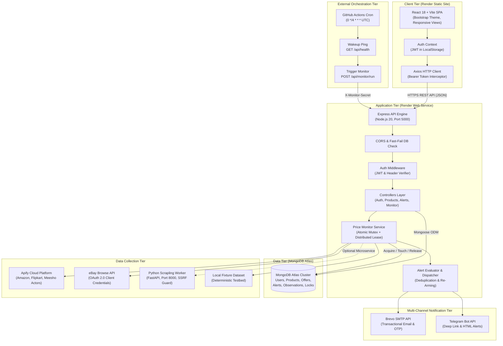
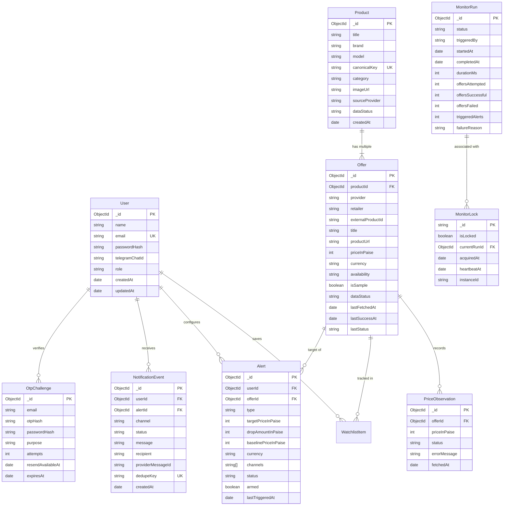
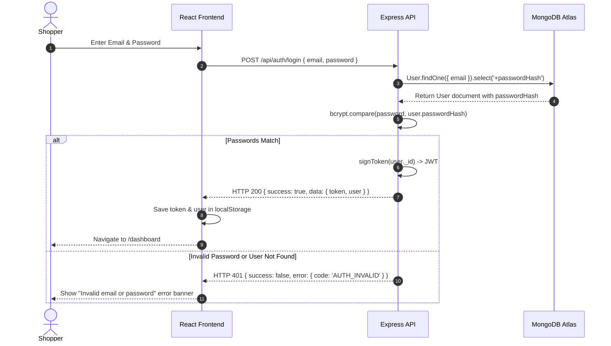
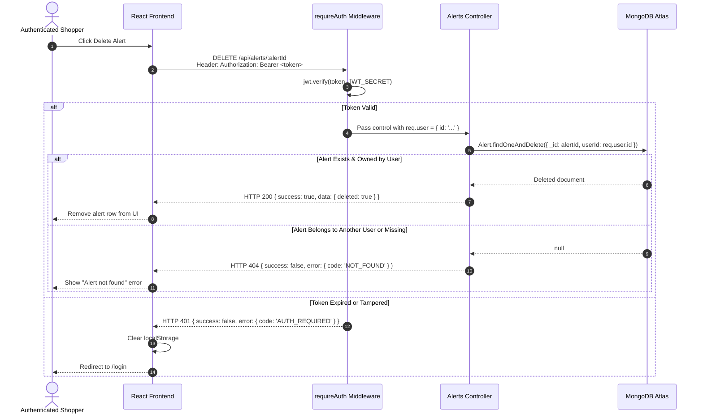
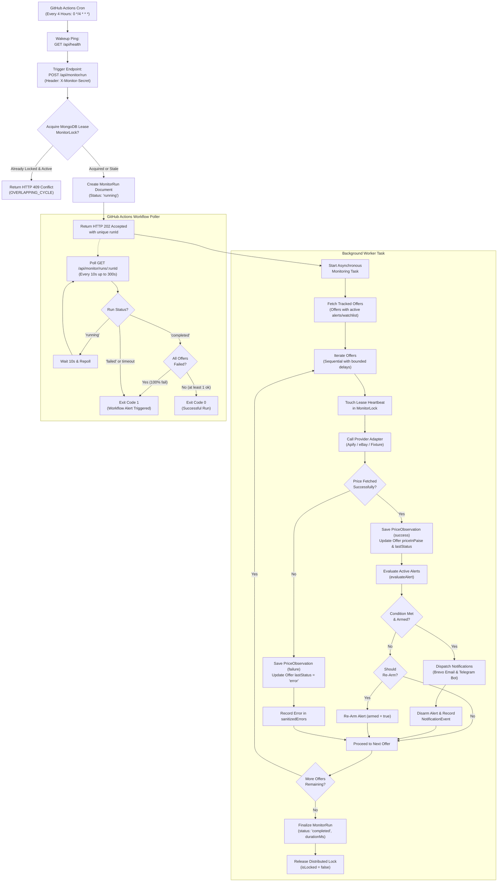

# PriceRadar — Complete System Architecture and Technical Reference Manual

> **Document Status:** Verified Production & Source Implementation  
> **Repository:** `https://github.com/VamshiYamjala/PriceR`  
> **Default Branch:** `main`  
> **Inspection Date:** October 2026  
> **Audited Commit:** `d845454b543b8713ca174b5f027d6f180d737e45`  
> **Deployment URLs:**  
> - **Production Frontend:** `https://priceradar-web.onrender.com`  
> - **Production Backend API:** `https://priceradar-api-02ib.onrender.com`  

---

## Table of Contents

1. [Project Overview](#1-project-overview)
2. [Functional and Non-Functional Requirements](#2-functional-and-non-functional-requirements)
3. [Technology Stack](#3-technology-stack)
4. [System Architecture](#4-system-architecture)
5. [Repository and Folder Structure](#5-repository-and-folder-structure)
6. [Frontend Documentation](#6-frontend-documentation)
7. [Backend Documentation](#7-backend-documentation)
8. [Database Design](#8-database-design)
9. [API Documentation](#9-api-documentation)
10. [Authentication and Authorization](#10-authentication-and-authorization)
11. [Product Search and Price Comparison](#11-product-search-and-price-comparison)
12. [Retailer Integrations and Data Collection](#12-retailer-integrations-and-data-collection)
13. [Four-Hour Price Monitoring Engine](#13-four-hour-price-monitoring-engine)
14. [Price Alert Engine](#14-price-alert-engine)
15. [Notification System](#15-notification-system)
16. [Python Worker and Scrapling](#16-python-worker-and-scrapling)
17. [Environment Configuration](#17-environment-configuration)
18. [Local Development Setup](#18-local-development-setup)
19. [Testing Strategy](#19-testing-strategy)
20. [CI/CD and Deployment](#20-cicd-and-deployment)
21. [Security Best Practices](#21-security-best-practices)
22. [Error Handling and Troubleshooting](#22-error-handling-and-troubleshooting)
23. [Known Limitations and Future Improvements](#23-known-limitations-and-future-improvements)
24. [Glossary](#24-glossary)
25. [Quick Reference](#25-quick-reference)

---

## 1. Project Overview

### 1.1 Problem Statement
E-commerce shoppers in India and global markets face fragmented pricing across major online retailers including Amazon, Flipkart, Meesho, and eBay. Prices fluctuate frequently due to dynamic pricing algorithms, flash sales, and seller adjustments. Manually monitoring product pages across multiple retailer websites is tedious, error-prone, and time-consuming. Shoppers frequently miss optimal price drops or purchase products immediately before steep promotional discounts.

### 1.2 Motivation and Purpose
PriceRadar was created to provide a unified, autonomous price tracking and comparison platform. The platform periodically inspects tracked product listings across supported retailers without requiring the user to keep browser tabs open, maintain an active session, or leave their personal computers running. When target price conditions or fixed drop thresholds are satisfied, the system immediately dispatches transactional alerts across Email and Telegram.

### 1.3 Main Objectives
- **Centralized Search & Discovery:** Aggregate and display competing retailer offers for consumer electronic products.
- **Autonomous Periodic Scraping:** Reliably refresh tracked listing prices every four hours via an asynchronous monitoring pipeline.
- **Deterministic Alert Engine:** Support strict target-price (`target_price`) and fixed-drop (`fixed_drop`) trigger conditions with anti-flapping re-arming and deduplication.
- **Multi-Channel Dispatch:** Deliver immediate, transactional notifications via Brevo Email and Telegram Bot API.
- **System Observability & Isolation:** Provide diagnostic tools, strict user isolation across tenant data, atomic distributed locking, and transparent labeling of live versus simulated sample catalog data.

### 1.4 Intended Users
- **Bargain Hunters & Smart Shoppers:** Users waiting for high-value items (smartphones, laptops, cameras, audio gear) to drop below target price thresholds.
- **System Administrators & Developers:** Engineers maintaining data collection adapters, scheduling pipelines, and service health across cloud deployments.

### 1.5 Core Features
- User registration with cryptographic 6-digit email OTP verification via Brevo.
- Secure session management using JSON Web Tokens (JWT) and bcrypt password hashing.
- Product search across MongoDB catalogs with live discovery fallbacks to Apify and eBay.
- Watchlist management to track individual retailer offers.
- Configurable price alerts specifying target price in paise, fixed drop amounts, and notification channels.
- Distributed price monitoring engine backed by an atomic MongoDB distributed lease (`MonitorLock`) and execution audit logging (`MonitorRun`).
- External cron scheduling via GitHub Actions targeting Render-hosted endpoints with automatic cold-start wakeup pings.
- Telegram account linking via secure single-use codes and deep-link bot interactions (`/start <code>`).
- Comprehensive diagnostic suite covering 9 subsystem categories (A through I) with security protections in production.

### 1.6 Current Implementation Status
| Feature Area | Status | Verification Detail |
|---|---|---|
| User Authentication (Email/Password) | **Implemented & Verified** | Full JWT lifecycle, bcrypt hashing, `/api/auth/me`. |
| Email OTP Registration Flow | **Implemented & Verified** | 6-digit challenge, TTL expiration, resend cooldown, Brevo delivery. |
| Product & Offer Catalog | **Implemented & Verified** | MongoDB storage, category filtering, autocomplete, offer summaries. |
| Watchlist Management | **Implemented & Verified** | User-isolated CRUD on individual retailer listings. |
| Price Alert Rules | **Implemented & Verified** | Target price & fixed drop evaluation, baseline tracking, auto-disarm. |
| Asynchronous Price Monitor | **Implemented & Verified** | HTTP 202 Accepted, unique `runId`, polling endpoint, mutex + lease. |
| 4-Hour Cron Workflow | **Implemented & Verified** | `.github/workflows/monitor.yml` running every 4 hours with wake-up ping. |
| Email Notifications | **Implemented & Verified** | Brevo SMTP API v3 with deduplication and delivery audit logging. |
| Telegram Bot Integration | **Implemented & Verified** | Deep linking, long-polling listener, HTML message delivery. |
| Apify Data Collection | **Implemented** | Amazon, Flipkart, Meesho actors; currently requires active token in production. |
| eBay Browse API | **Implemented** | OAuth 2.0 client credentials; sandbox/production toggle. |
| Python Scrapling Worker | **Implemented (Standalone)** | FastAPI service with SSRF protection; tested locally on port 8000. |

---

## 2. Functional and Non-Functional Requirements

### 2.1 Functional Requirements

```
+---------------------------------------------------------------------------------------------------+
| ID    | Requirement Area           | Functional Specification                                     |
+---------------------------------------------------------------------------------------------------+
| FR-01 | Registration & Onboarding  | User submits name, email, password. System dispatches 6-digit |
|       |                            | OTP via Brevo. User verifies OTP to activate account.         |
| FR-02 | User Authentication        | Authenticates credentials, issues signed JWT (7-day default), |
|       |                            | rejects invalid or malformed credentials.                     |
| FR-03 | Product Search & Discovery | Users search by keyword or category. System queries MongoDB;  |
|       |                            | falls back to live external providers if query permits.       |
| FR-04 | Offer Comparison           | Displays multiple retailer offers per product. Compares price |
|       |                            | in integer paise; highlights lowest valid offer.              |
| FR-05 | Watchlist Operations       | Authenticated users add or remove specific retailer offers.   |
|       |                            | Enforces unique constraint (user cannot add same offer twice).|
| FR-06 | Alert Configuration        | Configures alerts for target price or fixed drop amount.      |
|       |                            | Allows selection of email, telegram, or both.                 |
| FR-07 | Immediate Alert Evaluation | If a created target price alert is already satisfied by the   |
|       |                            | current price, triggers immediately and disarms.              |
| FR-08 | 4-Hour Background Refresh  | Checks tracked offers on a 4-hour cycle. Updates prices,      |
|       |                            | creates PriceObservation records, and flags errors.          |
| FR-09 | Alert Trigger & Disarm     | Evaluates active alerts against new observations. Notifies     |
|       |                            | user, disarms alert to prevent re-triggering, logs event.     |
| FR-10 | Alert Re-Arming Lifecycle  | If market price rises back above threshold, alert re-arms     |
|       |                            | automatically to capture future price drops.                  |
| FR-11 | Multi-Channel Notifications| Dispatches email via Brevo and Telegram message via Bot API.  |
| FR-12 | Telegram Account Linking   | Generates single-use 6-character code with Telegram deep link.|
|       |                            | Long-polling bot listener captures `/start <code>` to link.   |
| FR-13 | System Diagnostics         | Runs diagnostic checks across 9 categories. Public production |
|       |                            | inspection is blocked unless authorized with secret key.      |
+---------------------------------------------------------------------------------------------------+
```

### 2.2 Non-Functional Requirements
- **Security:**
  - Password hashing via bcrypt (work factor 10).
  - JWT tokens signed using HMAC SHA-256 with minimum 32-character secret keys.
  - Rate limiting on public and sensitive endpoints (OTP resend cooldown, Telegram code generation).
  - Production diagnostic shielding requiring `X-Diagnostic-Secret`.
  - Machine-to-machine monitoring trigger secured by `X-Monitor-Secret`.
- **Reliability & Concurrency:**
  - Double-locking mechanism: In-process JavaScript event-loop mutex combined with an atomic MongoDB distributed document lease (`MonitorLock`).
  - Stale lease recovery with 15-minute expiration window to automatically clear locks if a container experiences an abrupt SIGTERM.
  - Strict integer arithmetic using currency subunits (Indian Paise: ₹1.00 = 100 paise) preventing floating-point rounding errors.
- **Observability:**
  - Persistent run tracking in MongoDB (`MonitorRun`) capturing start time, duration, attempt counts, success/failure counts, and sanitized error messages.
  - Immutable notification event logging (`NotificationEvent`) with deduplication keys (`alertId:price:channel`).
- **Data Integrity:**
  - Unique compound database indexes preventing duplicate watchlist entries, duplicate listings, and duplicate notification deliveries.
  - Transparent labeling: Sample catalog data is explicitly flagged (`isSample: true`, `dataStatus: "sample"`) and barred from participating in genuine market savings claims.

---

## 3. Technology Stack

| Layer / Technology | Verified Version | Purpose | Location | Usage Details |
|---|---|---|---|---|
| **Node.js** | `>=18.0.0` (LTS v20 used in CI) | Backend Runtime Environment | `server/` | Executes Express API, Mongoose ORM, and async monitoring tasks. |
| **Express** | `^4.19.2` | HTTP Web Application Framework | `server/src/app.js` | Handles routing, CORS, JSON parsing, error handling, and API endpoints. |
| **Mongoose** | `^8.5.0` | Object Data Modeling (ODM) | `server/src/models/` | Schema validation, type casting, indexes, and queries for MongoDB. |
| **MongoDB Atlas** | `v7.0` Compatible | Primary Document Database | Cloud Managed | Persistent store for users, products, offers, alerts, and monitor runs. |
| **React** | `^18.3.1` | Frontend UI Library | `client/src/` | Component-based single-page application (SPA). |
| **Vite** | `^5.3.4` | Frontend Build Tool & Dev Server | `client/vite.config.js` | Fast HMR development and optimized production asset bundling. |
| **React Router DOM** | `^6.24.1` | Client-Side Routing | `client/src/App.jsx` | Declarative routing with protected routes and error boundary wrapper. |
| **Axios** | `^1.7.2` (Client) / `^1.20.0` (Server) | Promise-based HTTP Client | `client/src/services/api.js`, `server/src/` | API communication with backend; outbound calls to Brevo, Apify, eBay, Telegram. |
| **jsonwebtoken** | `^9.0.2` | Authentication Token Engine | `server/src/controllers/authController.js` | Issues and verifies signed JWTs for session authorization. |
| **bcryptjs** | `^2.4.3` | Cryptographic Password Hasher | `server/src/controllers/authController.js` | Salted one-way hashing of user passwords. |
| **express-validator** | `^7.1.0` | Request Input Validation | `server/src/middleware/validate.js` | Sanitizes and validates query parameters and JSON request bodies. |
| **Brevo API** | REST API v3 | Transactional Email Service | `server/src/services/notifications/email.js` | Dispatches OTP verification emails and price-drop notification alerts. |
| **Telegram Bot API** | Bot API v6+ | Instant Mobile Messaging | `server/src/services/notifications/telegram.js` | Outbound alert messages; inbound polling listener for account linking. |
| **Apify SDK & REST** | API v2 | External E-commerce Scraping | `server/src/providers/apify.js` | Cloud actors scraping live listings from Amazon, Flipkart, and Meesho. |
| **eBay Browse API** | Buy API v1 | Genuine Marketplace Integration | `server/src/providers/ebay.js` | Official OAuth 2.0 client credentials catalog search and price lookup. |
| **FastAPI** | `>=0.110.0` | Python Extraction Microservice | `worker/main.py` | Standalone high-performance service for localized web scraping. |
| **Scrapling** | `>=0.2.0` | Python Scraping Core | `worker/extractor.py` | Specialized HTML parser with SSRF protection and domain allowlisting. |
| **Jest** | `^29.7.0` | Backend Test Framework | `server/package.json` | Executes 25 test suites with native ES Module support (`--experimental-vm-modules`). |
| **Supertest** | `^7.0.0` | HTTP Integration Testing | `server/tests/` | Simulates HTTP requests against Express `app` without socket binding. |
| **GitHub Actions** | Hosted Ubuntu Runners | CI/CD & Scheduled Monitoring | `.github/workflows/` | Runs backend tests, builds frontend, and executes 4-hour cron monitor. |
| **Render** | Cloud PaaS | Production Application Hosting | External Dashboard | Decoupled hosting: Backend Web Service + Frontend Static Site. |

---

## 4. System Architecture

PriceRadar is engineered as a decoupled, multi-tier system. The React Single Page Application communicates via authenticated REST requests with the Node.js Express backend. The backend persists data in MongoDB Atlas and coordinates data collection across Apify cloud actors, the eBay Browse API, and optional local worker microservices.

### 4.1 Architecture Diagram



### 4.2 Synchronous Request Flow
1. User interacts with the React frontend (e.g., adding an offer to a watchlist or creating a price alert).
2. The centralized Axios client attaches the stored JWT in the `Authorization: Bearer <token>` header.
3. Express routes the request through CORS checks and the fast-fail database connectivity check.
4. `requireAuth` middleware verifies the token and populates `req.user`.
5. The corresponding controller executes the database operation, validates inputs via `express-validator`, and returns a standardized `{ success: true, data: { ... } }` JSON envelope.

### 4.3 Asynchronous Monitoring Flow
1. GitHub Actions initiates a scheduled run every 4 hours.
2. The workflow issues a cold-start wakeup ping to `/api/health`.
3. The workflow sends `POST /api/monitor/run` with the `X-Monitor-Secret` header.
4. The backend acquires an atomic distributed lease in `MonitorLock`, initializes a `MonitorRun` document, launches the background execution, and returns `HTTP 202 Accepted` with a unique `runId`.
5. The background job fetches prices, updates `Offer` records, appends `PriceObservation` entries, evaluates active `Alert` documents, and dispatches Brevo/Telegram notifications.
6. The GitHub Actions workflow polls `/api/monitor/runs/:runId` until completion and exits with code `0` on success or code `1` if all offers fail.

---

## 5. Repository and Folder Structure

```
D:\priceR
├── .github/
│   └── workflows/
│       ├── ci.yml                 # Continuous Integration: Backend tests, database seed, frontend build
│       └── monitor.yml            # 4-hour scheduled monitoring cron, wake-up ping, run status polling
├── client/                        # Frontend application (React 18 + Vite)
│   ├── public/                    # Static public assets
│   ├── src/
│   │   ├── components/            # Reusable UI elements (Navbar, Footer, ErrorBoundary, ProductCard, OfferRow)
│   │   ├── context/               # Global state contexts (AuthContext with persistent LocalStorage)
│   │   ├── pages/                 # Full-page route views (Search, ProductDetail, Watchlist, Alerts, Dashboard)
│   │   ├── services/              # API abstraction layer (api.js with Axios interceptors)
│   │   ├── styles/                # CSS styling rules (theme.css with CSS custom properties)
│   │   ├── App.jsx                # Route declarations and root layout wrapper
│   │   └── main.jsx               # React DOM bootstrap entrypoint
│   ├── .env.example               # Frontend environment template (VITE_API_URL)
│   ├── index.html                 # HTML shell and root mounting point
│   ├── package.json               # Frontend dependencies and Vite scripts
│   └── vite.config.js             # Vite build and development configuration
├── docs/                          # Architecture guides, PDF specifications, and deployment runbooks
│   ├── IMPLEMENTATION-AUDIT.md    # Historical implementation review
│   ├── RENDER_DEPLOYMENT.md       # Complete step-by-step Render setup guide
│   └── RENDER_DEPLOYMENT_AUDIT.md # Operational verification checklists
├── server/                        # Backend application (Node.js + Express + Mongoose)
│   ├── src/
│   │   ├── config/                # Centralized configurations (db.js connection lifecycle, env.js loader)
│   │   ├── controllers/           # HTTP request controllers (auth, products, offers, alerts, monitor)
│   │   ├── jobs/                  # CLI utilities and maintenance scripts (seedFixtures, verifyDb, runMonitor)
│   │   ├── middleware/            # Express middleware (auth, validate, rateLimiter, errorHandler)
│   │   ├── models/                # Mongoose database schemas (User, Product, Offer, Alert, MonitorRun)
│   │   ├── providers/             # Retailer adapters (apify.js, ebay.js, scrapling.js, fixture.js)
│   │   ├── routes/                # Express router mounts (/api/auth, /api/products, /api/monitor)
│   │   ├── services/              # Core business services (priceMonitor, alertEvaluator, alertDispatcher)
│   │   │   └── notifications/     # Outbound dispatchers (email.js via Brevo, telegram.js via Bot API)
│   │   ├── utils/                 # General utility helpers (asyncHandler, money integer arithmetic)
│   │   ├── app.js                 # Express server configuration and middleware mounting
│   │   └── server.js              # Application entrypoint, HTTP port binding, and service startup
│   ├── tests/                     # 25 automated backend test suites (Jest + Supertest)
│   ├── .env.example               # Backend environment template with configuration documentation
│   └── package.json               # Backend dependencies and test runner scripts
├── worker/                        # Standalone Python web extraction microservice (FastAPI + Scrapling)
│   ├── extractor.py               # Extraction core with SSRF guards and allowed domain validation
│   ├── main.py                    # FastAPI server exposing /health and /extract endpoints
│   ├── requirements.txt           # Python library requirements (FastAPI, uvicorn, scrapling, pydantic)
│   └── test_extractor.py          # Pytest validation for URL and price parsing
├── .gitignore                     # Git exclusions for dependencies, environments, build artifacts, caches
├── ERROR_LOG.md                   # Chronological development bug tracker and diagnostic log
├── PROGRAM_TRACKER.md             # Project phase completion checklist
└── README.md                      # High-level project summary and quick links
```

---

## 6. Frontend Documentation

### 6.1 Architecture and Layout
The frontend is built using **React 18** and **Vite**, structured around a Single Page Application (SPA) architecture. The main application is wrapped inside [`client/src/App.jsx`](file:///d:/priceR/client/src/App.jsx) within an [`ErrorBoundary`](file:///d:/priceR/client/src/components/ErrorBoundary.jsx) and a global flexbox layout containing [`Navbar`](file:///d:/priceR/client/src/components/Navbar.jsx), the routed page view, and [`Footer`](file:///d:/priceR/client/src/components/Footer.jsx).

### 6.2 Application Route Inventory
All client-side routes are declared in [`client/src/App.jsx`](file:///d:/priceR/client/src/App.jsx):

| Route Path | Component | Purpose | Access Control |
|---|---|---|---|
| `/` | `HomePage` | Hero section, featured deals, quick search bar, value propositions | Public |
| `/search` | `SearchPage` | Product search with category filters, retailer filters, and price ranges | Public |
| `/products/:productId` | `ProductDetailPage` | Detailed product specifications, competing retailer offer list, price history chart | Public |
| `/register` | `RegisterPage` | Two-step user registration with 6-digit email OTP verification | Public (Guest) |
| `/login` | `LoginPage` | User login form accepting email and password | Public (Guest) |
| `/dashboard` | `DashboardPage` | Overview of watched items, active alerts, and quick price refresh trigger | Authenticated |
| `/watchlist` | `WatchlistPage` | Grid and list view of user-saved retailer offers with removal controls | Authenticated |
| `/alerts` | `AlertManagementPage` | Inventory of active and paused alerts, trigger history, and status toggles | Authenticated |
| `/alerts/new` | `AlertFormPage` | Creation form for setting target price or fixed drop on an offer | Authenticated |
| `/alerts/:alertId/edit` | `AlertFormPage` | Edit form to adjust thresholds, status, or notification channels | Authenticated |
| `/settings/notifications`| `NotificationPreferencesPage` | Email settings and interactive Telegram bot linking interface | Authenticated |
| `/notifications` | `NotificationHistoryPage` | Audit log of dispatched alerts across email and Telegram channels | Authenticated |
| `/diagnostics` | `DiagnosticsPage` | 9-category system health dashboard (protected in production) | Public / Protected |
| `*` | `NotFoundPage` | Standard 404 error page with navigation links back to search | Public |

### 6.3 State Management and Authentication Context
Global authentication state is managed through [`client/src/context/AuthContext.jsx`](file:///d:/priceR/client/src/context/AuthContext.jsx) via standard React Context and the `useAuth()` custom hook.
- **Tokens & Session:** Stored in browser `localStorage` under `priceradar_token` and `priceradar_user`.
- **Session Persistence:** When the page reloads, initial state is derived synchronously from `localStorage`, preventing unwanted logouts during navigation.
- **Route Guarding:** [`ProtectedRoute.jsx`](file:///d:/priceR/client/src/components/ProtectedRoute.jsx) wraps authenticated pages; unauthenticated users are redirected to `/login` with the attempted path stored in navigation state.

### 6.4 API Layer and Axios Interceptor
All backend requests are routed through the singleton Axios instance in [`client/src/services/api.js`](file:///d:/priceR/client/src/services/api.js):
- **Base URL Normalization:** Automatically strips trailing slashes and redundant `/api` suffixes from `import.meta.env.VITE_API_URL`.
- **Request Interceptor:** Automatically inspects `localStorage` for `priceradar_token`. If present, it injects the header:
  ```http
  Authorization: Bearer <token>
  ```
- **Response Unwrapping:** An internal helper function `unwrap(promise)` automatically unwraps the backend response envelope (`res.data.data`), delivering the raw payload directly to UI components while forwarding rejected promises to component error handlers.

---

## 7. Backend Documentation

### 7.1 Initialization and Middleware Stack
The Express application is configured in [`server/src/app.js`](file:///d:/priceR/server/src/app.js) and bound to a port in [`server/src/server.js`](file:///d:/priceR/server/src/server.js). The middleware stack executes in strict sequence:

1. **Environment Initialization:** [`server/src/config/env.js`](file:///d:/priceR/server/src/config/env.js) ensures absolute resolution of `server/.env`.
2. **CORS Middleware:** Validates incoming `Origin` against `process.env.CLIENT_ORIGIN` (supports comma-separated origins, wildcards, and originless machine requests).
3. **JSON Body Parser:** Parses incoming requests via `express.json()`.
4. **Health Check (`GET /api/health`):** Bypasses all authentication and database fast-fail checks. Returns HTTP 200 if MongoDB connection `readyState === 1`, or HTTP 503 if disconnected.
5. **Database Fast-Fail Middleware:** Protects all non-diagnostic `/api` routes in non-test modes. If the database is disconnected, it immediately rejects the request with HTTP 503 (`DATABASE_DISCONNECTED`) instead of letting requests hang.
6. **Router Mounting:** Mounts sub-routers at `/api/auth`, `/api/products`, `/api/offers`, `/api/watchlist`, `/api/alerts`, `/api/notifications`, `/api/notification-preferences`, `/api/telegram`, `/api/monitor`, and `/api/diagnostics`.
7. **404 Catch-All:** Any unmatched path returns HTTP 404 (`NOT_FOUND`).
8. **Centralized Error Handler:** [`server/src/middleware/errorHandler.js`](file:///d:/priceR/server/src/middleware/errorHandler.js) catches unhandled errors and formats them into a uniform JSON response.

### 7.2 Backend Route Inventory

| Method | Endpoint Path | Auth Required | Description |
|---|---|---|---|
| `GET` | `/api/health` | None | Service liveness probe returning database connectivity state |
| `POST`| `/api/auth/register/initiate` | None | Validates user data, generates 6-digit OTP, dispatches email via Brevo |
| `POST`| `/api/auth/register/verify` | None | Verifies OTP code, persists new `User`, returns JWT |
| `POST`| `/api/auth/register/resend` | None | Resends fresh OTP if 60-second cooldown has elapsed |
| `POST`| `/api/auth/register` | None | Direct registration endpoint used primarily by automated test suites |
| `POST`| `/api/auth/login` | None | Authenticates email and password, returns JWT and user profile |
| `GET` | `/api/auth/me` | JWT | Returns authenticated user's profile and Telegram link status |
| `GET` | `/api/products/search` | None | Searches products by keyword, category, or retailer with live fallback |
| `GET` | `/api/products/categories` | None | Returns list of supported product categories |
| `GET` | `/api/products/autocomplete` | None | Returns quick typeahead suggestions for search queries |
| `GET` | `/api/products/providers/status`| None | Returns operational configuration status of Apify and eBay providers |
| `GET` | `/api/products/:productId` | None | Returns product details and all associated retailer offers |
| `GET` | `/api/offers/:offerId` | None | Returns single offer details |
| `GET` | `/api/offers/:offerId/history` | None | Returns historical `PriceObservation` records for price charts |
| `GET` | `/api/watchlist` | JWT | Lists all saved watchlist items for the authenticated user |
| `POST`| `/api/watchlist` | JWT | Adds an offer to the authenticated user's watchlist |
| `DELETE`| `/api/watchlist/:watchlistItemId`| JWT | Removes an item from the authenticated user's watchlist |
| `GET` | `/api/alerts` | JWT | Lists all price alerts configured by the authenticated user |
| `POST`| `/api/alerts` | JWT | Creates a new price alert; triggers immediately if already satisfied |
| `PATCH`| `/api/alerts/:alertId` | JWT | Updates threshold, channels, or paused status of an existing alert |
| `DELETE`| `/api/alerts/:alertId` | JWT | Deletes a price alert owned by the authenticated user |
| `GET` | `/api/notifications` | JWT | Returns notification delivery history for the authenticated user |
| `DELETE`| `/api/notifications/:id` | JWT | Deletes a notification event log entry owned by the user |
| `GET` | `/api/notification-preferences`| JWT | Returns user contact preferences and Telegram link status |
| `PUT` | `/api/notification-preferences`| JWT | Updates notification email preference |
| `POST`| `/api/telegram/link-code` | JWT | Generates short-lived 6-character code with bot deep link |
| `POST`| `/api/telegram/link` | JWT | Manually submits linking code (fallback for manual entry) |
| `POST`| `/api/telegram/disconnect` | JWT | Unlinks Telegram chat ID from user account |
| `POST`| `/api/monitor/run` | Secret | Triggers asynchronous monitoring cycle (requires `X-Monitor-Secret`) |
| `GET` | `/api/monitor/runs/:runId` | Secret/Admin | Polls status and results of a specific monitoring run |
| `GET` | `/api/monitor/status` | Secret/User | Returns high-level monitoring status and last run timestamp |
| `POST`| `/api/monitor/trigger` | JWT | On-demand monitoring refresh triggered by logged-in users from UI |
| `GET` | `/api/diagnostics` | Admin/Dev | Runs all 9 diagnostic check categories (A through I) |
| `GET` | `/api/diagnostics/sources/:id`| Admin/Dev | Runs deep connectivity check against eBay or Apify |

---

## 8. Database Design

The database layer utilizes **MongoDB Atlas** managed through **Mongoose**. All financial values are strictly represented as integers in currency subunits (Paise for INR: ₹10.50 = `1050`).

### 8.1 Entity-Relationship Diagram



### 8.2 Database Collections & Index Specifications

1. **`users` Collection ([`User.js`](file:///d:/priceR/server/src/models/User.js)):**
   - `email`: Indexed, Unique, Lowercase, Trimmed.
   - `passwordHash`: Configured with `select: false` to prevent accidental leakage in queries.
2. **`products` Collection ([`Product.js`](file:///d:/priceR/server/src/models/Product.js)):**
   - `canonicalKey`: Indexed, Unique, Lowercase. Serves as product deduplication key.
   - Indexed on `title`, `brand`, and `model` for regex search.
3. **`offers` Collection ([`Offer.js`](file:///d:/priceR/server/src/models/Offer.js)):**
   - Compound Unique Index: `{ provider: 1, externalProductId: 1 }` (stops duplicate listings).
   - `priceInPaise`: Integer validated (`Number.isInteger`).
4. **`priceobservations` Collection ([`PriceObservation.js`](file:///d:/priceR/server/src/models/PriceObservation.js)):**
   - Compound Query Index: `{ offerId: 1, fetchedAt: -1 }` (accelerates price history queries).
5. **`watchlistitems` Collection ([`WatchlistItem.js`](file:///d:/priceR/server/src/models/WatchlistItem.js)):**
   - Compound Unique Index: `{ userId: 1, offerId: 1 }` (stops duplicate watch items).
6. **`alerts` Collection ([`Alert.js`](file:///d:/priceR/server/src/models/Alert.js)):**
   - Indexed on `userId` and `offerId`.
   - Custom array validator ensuring at least one channel (`email` or `telegram`).
7. **`notificationevents` Collection ([`NotificationEvent.js`](file:///d:/priceR/server/src/models/NotificationEvent.js)):**
   - Compound Unique Index: `{ alertId: 1, dedupeKey: 1 }` (anti-spam deduplication guarantee).
8. **`otpchallenges` Collection ([`OtpChallenge.js`](file:///d:/priceR/server/src/models/OtpChallenge.js)):**
   - TTL Index: `{ expiresAt: 1 }` with `expireAfterSeconds: 0` (automatic MongoDB expiration).
9. **`monitorruns` Collection ([`MonitorRun.js`](file:///d:/priceR/server/src/models/MonitorRun.js)):**
   - Indexed on `status` and `startedAt`. Provides execution history.
10. **`monitorlocks` Collection ([`MonitorLock.js`](file:///d:/priceR/server/src/models/MonitorLock.js)):**
    - Singleton document with `_id: "monitoring_cycle_lock"`.
    - Indexed on `isLocked` and `heartbeatAt` for atomic lease acquisition.

---

## 9. API Documentation

### 9.1 Standard Response Envelope
All API endpoints return responses in a standardized JSON envelope:

**Success Response (HTTP 200 / 201 / 202):**
```json
{
  "success": true,
  "data": { ... }
}
```

**Error Response (HTTP 400 / 401 / 403 / 404 / 409 / 429 / 503):**
```json
{
  "success": false,
  "error": {
    "code": "ERROR_CODE_STRING",
    "message": "Human-readable explanation of error."
  }
}
```

### 9.2 Key Endpoint Specifications

#### 1. Registration Initiation
- **Endpoint:** `POST /api/auth/register/initiate`
- **Auth:** None
- **Body:**
  ```json
  {
    "name": "Jane Shopper",
    "email": "jane@example.com",
    "password": "SecurePassword123"
  }
  ```
- **Response (HTTP 200):**
  ```json
  {
    "success": true,
    "data": {
      "email": "jane@example.com",
      "message": "Verification code sent to your email address.",
      "resendCooldownSeconds": 60
    }
  }
  ```

#### 2. Registration Verification
- **Endpoint:** `POST /api/auth/register/verify`
- **Auth:** None
- **Body:**
  ```json
  {
    "email": "jane@example.com",
    "otp": "482910"
  }
  ```
- **Response (HTTP 201):**
  ```json
  {
    "success": true,
    "data": {
      "token": "eyJhbGciOiJIUzI1NiIsInR5cCI6IkpXVCJ9...",
      "user": {
        "id": "66bc10f24e93012a884f1122",
        "name": "Jane Shopper",
        "email": "jane@example.com",
        "telegramChatId": null
      }
    }
  }
  ```

#### 3. Product Search
- **Endpoint:** `GET /api/products/search?q=sony+headphones&category=audio`
- **Auth:** None
- **Query Params:** `q` (string), `category` (string), `provider` (string), `retailer` (string)
- **Response (HTTP 200):**
  ```json
  {
    "success": true,
    "data": {
      "products": [
        {
          "id": "66bc11a04e93012a884f1155",
          "title": "Sony WH-1000XM5 Wireless Noise Cancelling Headphones",
          "brand": "Sony",
          "category": "audio",
          "imageUrl": "https://example.com/sony.jpg",
          "dataStatus": "live",
          "offers": [
            {
              "id": "66bc11b54e93012a884f1188",
              "retailer": "amazon",
              "provider": "apify",
              "title": "Sony WH-1000XM5 (Black)",
              "priceInPaise": 2999000,
              "currency": "INR",
              "availability": "in_stock",
              "productUrl": "https://www.amazon.in/dp/B09X7MPX8L",
              "dataStatus": "live"
            }
          ]
        }
      ],
      "alternatives": []
    }
  }
  ```

#### 4. Create Price Alert
- **Endpoint:** `POST /api/alerts`
- **Auth:** `Bearer <token>`
- **Body:**
  ```json
  {
    "offerId": "66bc11b54e93012a884f1188",
    "type": "target_price",
    "targetPriceInPaise": 2800000,
    "channels": ["email", "telegram"]
  }
  ```
- **Response (HTTP 201):**
  ```json
  {
    "success": true,
    "data": {
      "alert": {
        "id": "66bc12014e93012a884f1199",
        "offerId": "66bc11b54e93012a884f1188",
        "type": "target_price",
        "targetPriceInPaise": 2800000,
        "channels": ["email", "telegram"],
        "status": "active",
        "armed": true,
        "createdAt": "2026-10-22T12:00:00.000Z"
      },
      "triggeredImmediately": false
    }
  }
  ```

#### 5. Trigger Monitoring Cycle (Machine-to-Machine)
- **Endpoint:** `POST /api/monitor/run`
- **Headers:** `X-Monitor-Secret: <MONITOR_TRIGGER_SECRET>`
- **Response (HTTP 202 Accepted):**
  ```json
  {
    "success": true,
    "data": {
      "started": true,
      "runId": "66bc13004e93012a884f1200",
      "status": "running",
      "offersChecked": 0,
      "triggeredAlerts": 0,
      "startedAt": "2026-10-22T12:00:01.123Z",
      "message": "Price monitoring cycle accepted and started in background."
    }
  }
  ```

#### 6. Poll Monitoring Run Status
- **Endpoint:** `GET /api/monitor/runs/:runId`
- **Headers:** `X-Monitor-Secret: <MONITOR_TRIGGER_SECRET>` (or Admin Bearer Token)
- **Response (HTTP 200):**
  ```json
  {
    "success": true,
    "data": {
      "runId": "66bc13004e93012a884f1200",
      "status": "completed",
      "triggeredBy": "github_actions",
      "startedAt": "2026-10-22T12:00:01.123Z",
      "completedAt": "2026-10-22T12:00:15.890Z",
      "durationMs": 14767,
      "offersAttempted": 5,
      "offersSuccessful": 5,
      "offersFailed": 0,
      "triggeredAlerts": 1,
      "errorsCount": 0,
      "errors": [],
      "failureReason": null
    }
  }
  ```

---

## 10. Authentication and Authorization

### 10.1 Password Security & JWT Mechanics
- **Password Storage:** Encrypted using `bcryptjs` with 10 salt rounds before persistence. Plaintext passwords never touch logs or databases.
- **JWT Signing:** Generated upon login and OTP verification using `jsonwebtoken` signed with `JWT_SECRET`. Tokens embed the subject claim `{ sub: user._id.toString() }` and expire after 7 days by default (`JWT_EXPIRES_IN`).
- **Identity Propagation:** The [`server/src/middleware/auth.js`](file:///d:/priceR/server/src/middleware/auth.js) middleware decodes the bearer token, verifies signature and expiration, and binds `{ id: decoded.sub, role: user.role }` to `req.user`.

### 10.2 Authentication Sequence Diagrams

#### Login Sequence


#### Protected Request & Ownership Enforcement


---

## 11. Product Search and Price Comparison

### 11.1 Search Routing & Normalization
When a search query is submitted:
1. **Local Catalog Search:** Searches existing MongoDB `Product` records using case-insensitive regular expressions across `title`, `brand`, and `model`. Matches are filtered by category if selected.
2. **Live Discovery Fallback:** If query matches live retailers, Apify (Amazon, Flipkart, Meesho) and eBay Browse API are invoked.
3. **Canonical Key Matching:** Products are deduplicated by generating a normalized `canonicalKey` (e.g., `"sony-wh-1000xm5-black"`). Discovered listings attach to the canonical product as competing `Offer` records.

### 11.2 Genuine Savings Calculation
Implemented in [`server/src/services/priceComparison.js`](file:///d:/priceR/server/src/services/priceComparison.js):
- **Eligibility:** Offers with `availability === 'out_of_stock'`, status `'error'`, or non-positive prices are strictly barred from lowest-price calculations.
- **Cross-Currency Safety:** Offers must share identical currency tags (`INR` vs `INR`). Cross-currency comparison is disallowed to prevent incorrect exchange rate assumptions.
- **Sample Data Safeguard:** If either the base offer or the comparison offer has `isSample: true` or `dataStatus: "sample"`, genuine market savings claims are rejected:
  ```javascript
  if (hasSampleData) {
    return { ...rawSavings, isGenuine: false, reason: 'Contains sample or simulated catalog data' };
  }
  ```

---

## 12. Retailer Integrations and Data Collection

### 12.1 Provider Registry
Retailer operations are dispatched through [`server/src/providers/index.js`](file:///d:/priceR/server/src/providers/index.js):

| Provider ID | Retailers Supported | Integration Method | Verified Operational State |
|---|---|---|---|
| `apify` | Amazon, Flipkart, Meesho | Apify Cloud Actor REST API v2 | **Implemented** (Requires valid `APIFY_API_TOKEN` on Render) |
| `ebay` | eBay Marketplace | Official eBay Browse API (OAuth 2.0) | **Implemented** (Sandbox / Production mode toggle) |
| `scrapling`| Testbeds (books.toscrape.com) | Standalone Python FastAPI microservice | **Implemented** (Port 8000 microservice with SSRF protection) |
| `fixture` | Amazon, Flipkart (Sample) | Deterministic JSON dataset | **Implemented** (Strictly isolated for automated Jest tests) |
| `amazon` | Direct Scraping | None (Strictly Prohibited by Policy) | **Safeguarded** (Direct scraping routes throw error; Apify actor used) |
| `flipkart`| Live Affiliate API | Direct Affiliate Feed | **Unwired** (Requires official affiliate approval; routed via Apify) |

### 12.2 Apify Data Collection Details
- **Actors Used:**
  - Amazon: `junglee/free-amazon-product-scraper`
  - Flipkart: `shahidirfan/Flipkart-Product-Scraper`
  - Meesho: `scrapeai/meesho-product-scraper`
- **Execution Mechanism:** Executes synchronous runs via `POST https://api.apify.com/v2/acts/<actorId>/run-sync-get-dataset-items` with bounded timeouts (default: 60s).
- **Listing ID Parsing:** Matches specific listings using ASIN, Flipkart Product ID, or URL regex matching.
- **Error Propagation:** Descriptive error parsing extracts HTTP 401 (invalid token), HTTP 403 (insufficient compute units or permissions), and HTTP 429 (rate limits).

---

## 13. Four-Hour Price Monitoring Engine

### 13.1 Architecture of the 4-Hour Background Monitor
On cloud platforms (such as Render Free Tier), backend containers sleep after 15 minutes of inactivity. An internal `setInterval` cannot fire when the instance is asleep. Furthermore, if a user shuts down their computer or logs out, no browser exists to trigger monitoring.

To solve this, PriceRadar uses a **decoupled external triggering architecture** via GitHub Actions:

```
[GitHub Actions 4-Hour Cron]
          │
          ▼ (Wakeup Ping)
   GET /api/health  ─────────► Wakes sleeping Render instance
          │
          ▼ (Trigger Job)
 POST /api/monitor/run ──────► Acquires Distributed Lock, returns HTTP 202 + runId
          │
          ▼ (Poll Status Loop)
 GET /api/monitor/runs/:id ──► Polls status until completed / failed / timeout
```

### 13.2 Monitoring Execution Flowchart



### 13.3 Cron Schedule Reference
The monitoring cron runs at `0 */4 * * *`:
- **UTC Schedule:** `00:00`, `04:00`, `08:00`, `12:00`, `16:00`, `20:00` UTC
- **India Standard Time (IST = UTC + 5:30):** `05:30`, `09:30`, `13:30`, `17:30`, `21:30`, `01:30` IST

---

## 14. Price Alert Engine

### 14.1 Alert Conditions
PriceRadar implements two distinct, deterministic alert rules in [`server/src/services/alertEvaluator.js`](file:///d:/priceR/server/src/services/alertEvaluator.js):

#### 1. Target Price Alert (`type: 'target_price'`)
- **Trigger Rule:** Triggers when observed price $\le$ user's target price:
  $$\text{currentPriceInPaise} \le \text{targetPriceInPaise}$$
- **Disarming:** Disarms (`armed: false`) immediately upon firing to prevent repetitive alerts on subsequent cycles.
- **Re-Arming:** Automatically re-arms (`armed: true`) if the market price rises back above the target price threshold.

#### 2. Fixed Drop Alert (`type: 'fixed_drop'`)
- **Trigger Rule:** Triggers when the price drops by at least the specified drop amount relative to its baseline:
  $$(\text{baselinePriceInPaise} - \text{currentPriceInPaise}) \ge \text{dropAmountInPaise}$$
- **Baseline Selection:** The alert stores `baselinePriceInPaise` at creation time. If missing, it falls back to the observation immediately preceding the drop.

### 14.2 Worked Pricing Examples

| Scenario | Alert Type | Configured Threshold | Baseline Price | Observed Price | Triggered? | Armed State After Cycle | Reason / Action |
|---|---|---|---|---|---|---|---|
| A | `target_price` | ₹25,000 (2,500,000 paise) | N/A | ₹24,999 (2,499,900 paise) | **YES** | Disarmed (`false`) | Price met target; notification sent. |
| B | `target_price` | ₹25,000 (2,500,000 paise) | N/A | ₹24,999 (cycle 2) | **NO** | Disarmed (`false`) | Condition met but already disarmed (anti-spam). |
| C | `target_price` | ₹25,000 (2,500,000 paise) | N/A | ₹26,500 (cycle 3) | **NO** | Re-armed (`true`) | Price rose above target; re-armed for next drop. |
| D | `fixed_drop` | ₹1,500 drop (150,000 paise) | ₹30,000 | ₹28,000 (2,800,000 paise) | **YES** | Disarmed (`false`) | Dropped by ₹2,000 ($\ge$ ₹1,500 threshold). |
| E | Provider Error | Any | ₹30,000 | ₹0 (fetch error) | **NO** | Retains Current | ₹0 and negative prices are safely rejected. |

---

## 15. Notification System

### 15.1 Multi-Channel Dispatch & Delivery Isolation
Notification dispatch is orchestrated by [`server/src/services/alertDispatcher.js`](file:///d:/priceR/server/src/services/alertDispatcher.js):
- **Brevo Email Service:** Uses Brevo SMTP REST API (`POST https://api.brevo.com/v3/smtp/email`). Sends branded HTML and plain-text emails containing the product title, savings summary, and direct retailer product URL.
- **Telegram Bot Service:** Uses Telegram Bot API (`POST https://api.telegram.org/bot<TOKEN>/sendMessage`). Sends rich HTML messages with product links.
- **Channel Independence:** If a user selects both Email and Telegram, dispatch failures on one channel do NOT block the other channel.
- **Partial Delivery Safeguard:** If Telegram fails (e.g. unlinked chat) but Email succeeds, the alert records partial delivery and retains `armed: true` so the pending channel is retried on the next monitoring cycle.
- **Deduplication Key:** Every event generates a canonical dedupe key:
  $$\text{dedupeKey} = \text{alertId} : \text{currentPriceInPaise} : \text{channel}$$
  MongoDB's unique index `{ alertId: 1, dedupeKey: 1 }` guarantees duplicate alerts are never dispatched twice for the same price event.

---

## 16. Python Worker and Scrapling

### 16.1 Microservice Architecture
Located in [`worker/`](file:///d:/priceR/worker/):
- **Framework:** FastAPI running on `127.0.0.1:8000`.
- **Primary Modules:**
  - `main.py`: Exposes `GET /health` and `POST /extract`.
  - `extractor.py`: Core extraction logic using Scrapling and regular expressions.
- **Security & SSRF Guard:**
  - Strict domain allowlist: `books.toscrape.com`, `quotes.toscrape.com`, `scrapingclub.com`.
  - DNS resolution guard: Resolves hostnames and rejects private, loopback, link-local, or cloud metadata IP addresses (`127.0.0.0/8`, `10.0.0.0/8`, `169.254.0.0/16`, `::1`).
  - Redirect validation: Validates final destination URLs after redirects.
- **Status:** Functional microservice. Used for testing localized Scrapling extraction. Not in the primary cloud path on Render (which uses Apify actors).

---

## 17. Environment Configuration

### 17.1 Environment Variable Reference Table

| Variable Name | Required? | Service | Purpose | Example Format |
|---|---|---|---|---|
| `PORT` | Optional | Backend | Local HTTP listen port (defaults to 5000) | `5000` |
| `NODE_ENV` | Required | Backend | Runtime mode (`development`, `production`, `test`) | `production` |
| `MONGODB_URI` | Required | Backend | MongoDB connection string | `mongodb+srv://<user>:<pw>@<cluster>.mongodb.net/priceradar` |
| `JWT_SECRET` | Required | Backend | Secret key for signing session JWTs ($\ge 32$ chars) | `<LONG_RANDOM_SECRET_KEY>` |
| `JWT_EXPIRES_IN` | Optional | Backend | Token validity duration (default: `7d`) | `7d` |
| `CLIENT_ORIGIN` | Required | Backend | Allowed CORS origins for frontend requests | `https://priceradar-web.onrender.com` |
| `MONITOR_TRIGGER_SECRET` | Required | Backend | Secret key authorizing `POST /api/monitor/run` | `<LONG_RANDOM_TRIGGER_SECRET>` |
| `MONITORING_ENABLED` | Optional | Backend | Master toggle for monitoring (`true`/`false`) | `true` |
| `BREVO_API_KEY` | Optional | Backend | API key for transactional email delivery | `xkeysib-<REST_OF_API_KEY>` |
| `EMAIL_FROM` | Optional | Backend | Verified sender email address for Brevo | `alerts@yourdomain.com` |
| `EMAIL_FROM_NAME` | Optional | Backend | Display name for outbound alert emails | `PriceRadar Alerts` |
| `TELEGRAM_BOT_TOKEN` | Optional | Backend | Bot token obtained from `@BotFather` | `123456789:ABCdefGhIJKlmNoPQRsTUVw` |
| `TELEGRAM_BOT_USERNAME` | Optional | Backend | Telegram bot username for deep linking | `PriceRadar_Alerts_Bot` |
| `APIFY_API_TOKEN` | Optional | Backend | Apify API token for live scraping actors | `apify_api_<TOKEN_STRING>` |
| `APIFY_ACTOR_AMAZON` | Optional | Backend | Actor ID for Amazon scraping | `junglee/free-amazon-product-scraper` |
| `APIFY_ACTOR_FLIPKART`| Optional | Backend | Actor ID for Flipkart scraping | `shahidirfan/Flipkart-Product-Scraper` |
| `APIFY_ACTOR_MEESHO` | Optional | Backend | Actor ID for Meesho scraping | `scrapeai/meesho-product-scraper` |
| `EBAY_CLIENT_ID` | Optional | Backend | eBay Developer App client ID | `<EBAY_APP_CLIENT_ID>` |
| `EBAY_CLIENT_SECRET` | Optional | Backend | eBay Developer App client secret | `<EBAY_APP_CLIENT_SECRET>` |
| `EBAY_ENV` | Optional | Backend | eBay environment (`sandbox` or `production`) | `sandbox` |
| `ADMIN_DIAGNOSTIC_SECRET`| Optional | Backend | Secret unlocking production `/api/diagnostics` | `<ADMIN_SECRET_KEY>` |
| `VITE_API_URL` | Required | Frontend | Backend API URL embedded into Vite static bundle | `https://priceradar-api-02ib.onrender.com` |

---

## 18. Local Development Setup

### 18.1 Prerequisites
- **Node.js:** v18.0.0 or v20.x LTS installed.
- **MongoDB:** Local MongoDB Community Server running on `127.0.0.1:27017` or a free MongoDB Atlas connection string.
- **Git:** Git installed.
- **Python (Optional):** Python 3.10+ if running the localized Scrapling microservice.

### 18.2 Step-by-Step Installation

#### 1. Clone Repository
```bash
git clone https://github.com/VamshiYamjala/PriceR.git
cd PriceR
```

#### 2. Backend Setup
```bash
cd server
npm install
cp .env.example .env
```
Edit `server/.env` and provide your MongoDB URI and random secrets:
```ini
PORT=5000
NODE_ENV=development
MONGODB_URI=mongodb://127.0.0.1:27017/priceradar_dev
JWT_SECRET=development-jwt-secret-at-least-32-characters-long
MONITOR_TRIGGER_SECRET=development-monitor-trigger-secret-12345
CLIENT_ORIGIN=http://localhost:5173
```

Seed initial product and offer fixtures:
```bash
npm run seed:fixtures
```

Start the backend server:
```bash
npm run dev
```
Backend will listen at `http://localhost:5000`. Test health: `http://localhost:5000/api/health`.

#### 3. Frontend Setup
Open a second terminal:
```bash
cd client
npm install
cp .env.example .env
```
Ensure `client/.env` points to your backend:
```ini
VITE_API_URL=http://localhost:5000
```
Start the frontend development server:
```bash
npm run dev
```
Open `http://localhost:5173` in your browser.

---

## 19. Testing Strategy

### 19.1 Automated Test Execution
The test suite consists of **25 Jest integration test suites** containing **263 automated tests**.

Run backend tests:
```bash
# In server/ directory
npm test
```

Run tests with open-handle detection:
```bash
npm test -- --detectOpenHandles
```

Run specific test suites:
```bash
npm test -- tests/monitorExecution.test.js tests/priceAlertMonitoring.test.js
```

### 19.2 Verified Test Coverage Matrix

| Test Suite File | Coverage Scope | Verified Result |
|---|---|---|
| `alertEvaluator.test.js` | Target price, fixed drop, currency mismatch, non-positive price safety | **PASS** |
| `apifyProvider.test.js` | Actor input building, price parsing, item normalization, error extraction | **PASS** |
| `auth.test.js` | Direct registration, login, JWT validation, `/api/auth/me` | **PASS** |
| `diagnostics.test.js` | Checks A through I, secret header protection, source verification | **PASS** |
| `ebayProvider.test.js` | Token caching, client credentials grant, Browse API parsing | **PASS** |
| `emailService.test.js` | Brevo payload structure, sender masking, failure resolution | **PASS** |
| `health.test.js` | HTTP 200 connected, HTTP 503 disconnected, 404 handler | **PASS** |
| `models.test.js` | Schema validation, unique indexes, paise integer constraints | **PASS** |
| `monitorExecution.test.js` | Asynchronous trigger, run status polling, distributed lock concurrency | **PASS** |
| `notificationFlow.test.js` | 10 core alert conditions, sample safeguards, user isolation | **PASS** |
| `priceAlertMonitoring.test.js`| Alert dispatch lifecycle, Brevo/Telegram delivery, partial failure | **PASS** |
| `products.test.js` | Product search, autocomplete, categories, fallback seeding | **PASS** |
| `registrationOtpFlow.test.js` | Step 1 OTP generation, Step 2 verification, resend cooldown | **PASS** |
| `scheduler.test.js` | In-process timer, overlapping cycle prevention, unref teardown | **PASS** |
| `watchlistAndAlerts.test.js` | Watchlist CRUD, immediate alert evaluation, isolation | **PASS** |

---

## 20. CI/CD and Deployment

### 20.1 Continuous Integration Pipeline (`.github/workflows/ci.yml`)
Triggers on every `push` and `pull_request` to `main`:
1. **Backend Job:**
   - Spins up an ephemeral `mongo:7.0` container service.
   - Installs dependencies via `npm ci`.
   - Seeds test database fixtures: `npm run seed:fixtures`.
   - Executes 25 Jest test suites: `npm test`.
2. **Frontend Job:**
   - Sets up Node.js 20.
   - Installs client dependencies: `npm ci`.
   - Builds production bundle: `npm run build`.

### 20.2 Production Hosting on Render
- **Backend Web Service (`priceradar-api-02ib`):**
  - Root directory: `server`
  - Build command: `npm install`
  - Start command: `npm start`
  - Health check path: `/api/health`
- **Frontend Static Site (`priceradar-web`):**
  - Root directory: `client`
  - Build command: `npm install && npm run build`
  - Publish directory: `dist`
  - Rewrite rule: `/*` $\rightarrow$ `/index.html` (Required for React Router SPA)

---

## 21. Security Best Practices

1. **Integer Arithmetic for Currency:** Avoids floating-point precision flaws by storing all monetary values in Paise.
2. **SSRF Guarding:** Python worker and scraping adapters strictly resolve destination IPs and reject private/internal IP ranges (`127.0.0.0/8`, `10.0.0.0/8`, AWS metadata `169.254.169.254`).
3. **Password & Token Hygiene:**
   - bcrypt with 10 salt rounds.
   - `passwordHash` omitted from query results by default (`select: false`).
   - Plaintext passwords and OTPs are never logged.
4. **Endpoint Security Separation:**
   - `MONITOR_TRIGGER_SECRET` authorizes background price refreshes.
   - `ADMIN_DIAGNOSTIC_SECRET` protects internal infrastructure diagnostics.
5. **Deduplication:** Unique MongoDB compound indexes protect against replay attacks, duplicate watchlist items, and repetitive alert dispatch.

---

## 22. Error Handling and Troubleshooting

| Symptom | Probable Cause | Diagnostic Step | Resolution |
|---|---|---|---|
| `/api/health` returns HTTP 503 | MongoDB Atlas disconnected or IP blocked | Check Render logs for `[db] Mongoose connection error` | Add Render regional outbound CIDR blocks to Atlas Network Access list. |
| Monitor returns `offersFailed: 5` with status 403 | Apify compute units exhausted or invalid token | Check run details: `GET /api/monitor/runs/:id` | Update `APIFY_API_TOKEN` in Render dashboard environment settings. |
| Frontend navigation shows 404 on page reload | Missing SPA rewrite rule on Render Static Site | Check browser URL upon reload | Add rewrite rule in Render: Source `/*`, Destination `/index.html`. |
| GitHub Actions monitor times out | Backend instance was sleeping (cold start) | Inspect workflow logs at `Trigger Remote Monitor` step | Wakeup ping (`GET /api/health`) ensures instance spins up before trigger. |
| Registration OTP not received | Brevo API key unconfigured or unverified sender | Check backend logs for `[auth-otp] Verification email dispatch failed` | Verify `BREVO_API_KEY` and `EMAIL_FROM` in `server/.env`. |
| Alert does not notify on drop | Alert was disarmed after previous trigger | Inspect alert document: check `armed` field | Normal behavior; alert re-arms automatically once price rises back above threshold. |

---

## 23. Known Limitations and Future Improvements

### 23.1 Confirmed Gaps & Operational Limitations
- **Apify Free Tier Quota:** Live scraping of Amazon/Flipkart depends on Apify compute units. Free accounts are limited to \$5 CU monthly and must be refreshed or upgraded for uninterrupted 4-hour live monitoring.
- **In-Process Background Memory on Free Render:** The asynchronous trigger relies on Render containers remaining active for several minutes. While sufficient for the 5-offer catalog, scaling to thousands of offers requires an external queue (e.g., BullMQ + Redis).
- **Direct Amazon & Flipkart Scraping Policy:** Direct DOM scraping of Amazon and Flipkart without proxies is actively blocked by anti-bot systems (Cloudflare, PerimeterX). Hence, Apify actors are necessary.

### 23.2 Planned Improvements
- Integration of Redis-backed BullMQ job queue for horizontally scalable distributed worker pools.
- WhatsApp notification delivery channel via Twilio or Meta Graph API.
- Chrome browser extension allowing shoppers to track any product listing directly while browsing retailer websites.

---

## 24. Glossary

- **MERN Stack:** Architecture consisting of MongoDB, Express.js, React, and Node.js.
- **Paise:** Subunit of Indian Rupee (₹1 = 100 paise). Used throughout PriceRadar to prevent floating-point rounding errors.
- **Apify Actor:** Cloud-hosted containerized scraping script that automates browser sessions to extract e-commerce data.
- **Distributed Lock:** Concurrency synchronization primitive guaranteeing that only one process executes a shared routine across multiple server instances.
- **Idempotency:** Property of operations that produce the exact same system state even when executed repeatedly.
- **Single Page Application (SPA):** Web app that loads a single HTML page and dynamically updates views via JavaScript routing without full-page reloads.
- **Time-to-Live (TTL) Index:** MongoDB index feature that automatically deletes documents after a specified time interval (used for OTP challenges).

---

## 25. Quick Reference

### 25.1 Key File Paths
- **Backend Entrypoint:** [`server/src/server.js`](file:///d:/priceR/server/src/server.js)
- **Express App Configuration:** [`server/src/app.js`](file:///d:/priceR/server/src/app.js)
- **Monitoring Workflow:** [`.github/workflows/monitor.yml`](file:///d:/priceR/.github/workflows/monitor.yml)
- **CI Test Workflow:** [`.github/workflows/ci.yml`](file:///d:/priceR/.github/workflows/ci.yml)
- **Price Monitor Engine:** [`server/src/services/priceMonitor.js`](file:///d:/priceR/server/src/services/priceMonitor.js)
- **Frontend Entrypoint:** [`client/src/App.jsx`](file:///d:/priceR/client/src/App.jsx)
- **API Client:** [`client/src/services/api.js`](file:///d:/priceR/client/src/services/api.js)

### 25.2 Key Commands
```bash
# Run backend test suite (25 suites, 263 tests)
cd server && npm test

# Run tests with open handle detection
cd server && npm test -- --detectOpenHandles

# Seed test database fixtures
cd server && npm run seed:fixtures

# Build frontend production bundle
cd client && npm run build

# Start backend dev server
cd server && npm run dev

# Start frontend dev server
cd client && npm run dev
```
