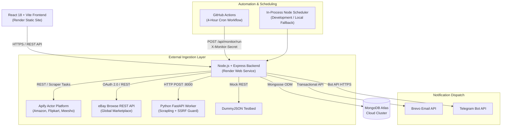
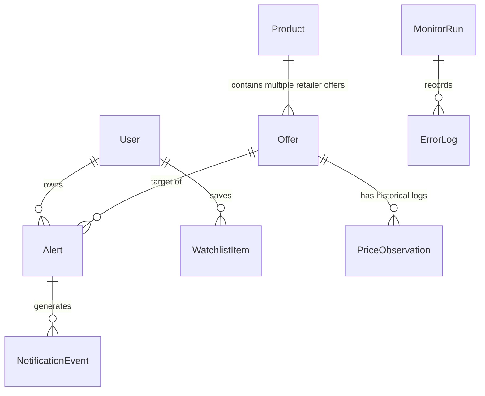
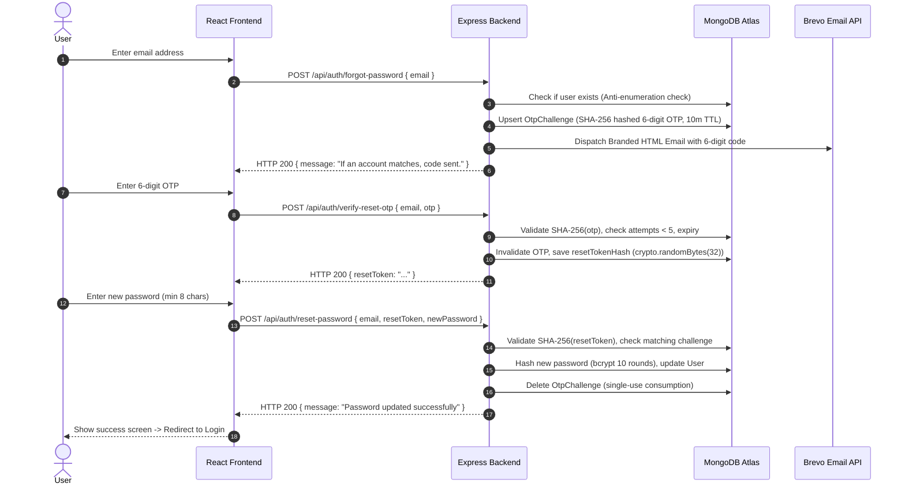

# PriceRadar — Complete Technical Interview & Viva Preparation Guide

> **Project:** PriceRadar (Multi-Retailer Price Tracking & Alert Engine)  
> **Repository:** [https://github.com/VamshiYamjala/PriceR](https://github.com/VamshiYamjala/PriceR)  
> **Production Frontend:** `https://priceradar-web.onrender.com`  
> **Production Backend:** `https://priceradar-api-02ib.onrender.com`  
> **Target Audience:** Engineering Candidates, Technical Interviewers, Project Evaluators, and Viva Voce Examiners  

---

## Table of Contents
1. [Core Project Overview & Architecture](#1-core-project-overview--architecture)
2. [Frontend Architecture & React 18](#2-frontend-architecture--react-18)
3. [Backend Engineering & Node.js / Express](#3-backend-engineering--nodejs--express)
4. [Database Modeling & MongoDB / Mongoose](#4-database-modeling--mongodb--mongoose)
5. [Authentication, Security & Password Reset (Email OTP)](#5-authentication-security--password-reset-email-otp)
6. [Data Extraction, Scrapers & Python Worker](#6-data-extraction-scrapers--python-worker)
7. [Price Evaluation Engine & Multi-Channel Notifications](#7-price-evaluation-engine--multi-channel-notifications)
8. [DevOps, CI/CD & Automated Monitoring](#8-devops-cicd--automated-monitoring)
9. [System Design, Scalability & Concurrency](#9-system-design-scalability--concurrency)
10. [Troubleshooting, Real-World Bugs & Project Defense](#10-troubleshooting-real-world-bugs--project-defense)

---

## 1. Core Project Overview & Architecture

### Q1: What is PriceRadar and what core problem does it solve?
**Answer:**  
PriceRadar is a full-stack, automated multi-store price monitoring and price-drop notification platform.  
**The Problem:** E-commerce shoppers waste hours manually checking multiple retailer websites (Amazon India, Flipkart, Meesho, eBay) to find the best deal. Retailers use dynamic algorithmic pricing that changes multiple times a day, meaning buyers frequently miss flash sales or sudden discounts.  
**The Solution:** PriceRadar aggregates product listings across disparate e-commerce marketplaces into a unified interface, tracks historical prices, and automatically executes a 4-hour background monitoring cycle. When a retailer's price drops below a user's configured threshold or by a specific amount, the system immediately dispatches real-time alerts via **Brevo Email** and **Telegram Bot**.

---

### Q2: Walk me through the end-to-end system architecture of PriceRadar.
**Answer:**  
PriceRadar employs a decoupled, multi-tier service-oriented architecture:



1. **Client Tier:** React 18 single-page application built with Vite, styled with a custom Forest Green (`#183C2B`) and Lime (`#CEEB5D`) design system, communicating with the backend via an Axios singleton instance.
2. **Server Tier:** Express.js REST API providing JWT authentication, user watchlist management, alert rule configuration, and monitoring orchestration.
3. **Ingestion Tier (Adapter Pattern):** A polymorphic provider engine routing requests to Apify, eBay Browse API, Python Scrapling worker, or testbed fixtures.
4. **Data Tier:** MongoDB Atlas with Mongoose schemas enforcing integer paise arithmetic, compound indexing, and sensitive field exclusion.
5. **Alert & Notification Tier:** An evaluation engine comparing fresh prices against alert conditions and dispatching alerts through Brevo (SMTP/API) and Telegram bots.
6. **Automation Tier:** A hardened GitHub Actions cron workflow (`0 */4 * * *`) that triggers the monitoring endpoint asynchronously, verifies distributed locks, and polls run status to completion.

---

### Q3: What is the complete technology stack and why was each technology chosen?
**Answer:**  
| Tier | Technology | Technical Justification |
| :--- | :--- | :--- |
| **Frontend** | React 18 + Vite | Fast HMR, optimized production tree-shaking, lightweight virtual DOM, and component-driven state architecture. |
| **Backend** | Node.js (ESM) + Express 4.19 | Asynchronous event-driven I/O ideal for orchestrating simultaneous network calls to scrapers and notification APIs. |
| **Database** | MongoDB Atlas + Mongoose 8.5 | Flexible document model accommodating varying product attributes across heterogeneous retailer catalogs without schema migration bottlenecks. |
| **Web Extraction** | Python 3 + FastAPI + Scrapling | High-performance HTML parsing, anti-bot mitigation, and strict SSRF allowlisting running in an isolated sub-process. |
| **Notifications** | Brevo API + Telegram Bot API | High-deliverability transactional emails combined with instantaneous push notifications on mobile devices. |
| **Automation** | GitHub Actions Cron | Serverless, zero-maintenance execution of background price checks every 4 hours, independent of user browser sessions. |

---

## 2. Frontend Architecture & React 18

### Q4: Why did you choose React + Vite over server-side frameworks like Next.js?
**Answer:**  
PriceRadar is primarily an authenticated dashboard and real-time monitoring application rather than a content-heavy SEO blog.  
1. **Performance & Build Speed:** Vite utilizes native ES modules (`esbuild`) during development, yielding cold starts under 300ms and production builds in under 1 second.
2. **Operational Simplicity:** A pure Single-Page Application (SPA) compiles down to static HTML, CSS, and JS bundles, enabling deployment on free global CDN edge servers (Render Static Sites) without running an expensive Node server for SSR.
3. **Decoupled Architecture:** Clean separation between client and backend API ensures the Express API can be consumed independently by web, mobile apps, or third-party webhooks.

---

### Q5: How is client-side authentication managed securely in the React app?
**Answer:**  
Authentication is encapsulated in [`client/src/context/AuthContext.jsx`](file:///d:/priceR/client/src/context/AuthContext.jsx):
- **Storage:** The JSON Web Token (JWT) is stored in `localStorage` under `token`, and user profile data under `user`.
- **Initialization:** On mount, `AuthContext` reads the stored token and validates its existence before setting `isAuthenticated = true`.
- **Automatic Header Injection:** In [`client/src/services/api.js`](file:///d:/priceR/client/src/services/api.js), an Axios request interceptor automatically attaches the `Authorization: Bearer <token>` header to all outgoing requests.
- **Route Protection:** A higher-order component [`ProtectedRoute.jsx`](file:///d:/priceR/client/src/components/ProtectedRoute.jsx) wraps sensitive routes (`/dashboard`, `/watchlist`, `/alerts`, `/notifications`). If `isAuthenticated` is false, it redirects the user to `/login`, preserving the intended destination in `location.state.from`.
- **Global Logout:** On 401 Unauthorized responses, Axios interceptors can invoke `logout()`, purging local state and redirecting to the login screen.

---

### Q6: How does the product search and live autocomplete work without overloading the backend?
**Answer:**  
Located in [`client/src/pages/SearchPage.jsx`](file:///d:/priceR/client/src/pages/SearchPage.jsx):
1. **Debouncing:** When a user types into the search hero box, a `setTimeout` timer (300ms) delays the autocomplete dispatch. If the user keystrokes again before 300ms, the previous timer is canceled via `clearTimeout`.
2. **Threshold Guard:** Queries with fewer than 2 characters are ignored to prevent useless single-character database table scans.
3. **Client-Side Filtering & Sorting:** After retrieving matching products, users can dynamically toggle sort options (`price_asc`, `price_desc`, `relevance`) instantly on the client side using JavaScript array `.sort()` without re-querying the backend.
4. **URL Synchronization:** Search parameters (`q`, `category`, `retailer`) are synced to URL query params using `useSearchParams()`, enabling bookmarking, sharing, and browser back/forward navigation.

---

### Q7: Why is `ErrorBoundary.jsx` implemented as an ES6 Class Component instead of a Functional Component?
**Answer:**  
In React 18, React's core error-handling lifecycle methods—`componentDidCatch(error, errorInfo)` and `static getDerivedStateFromError(error)`—**are only supported in Class components**.  
There is no functional hook equivalent (such as `useCatch` or `useErrorBoundary`) in React core. Therefore, [`client/src/components/ErrorBoundary.jsx`](file:///d:/priceR/client/src/components/ErrorBoundary.jsx) subclasses `React.Component`:
- It catches uncaught JavaScript errors in downstream child component rendering.
- Prevents the entire React application from crashing into a blank white screen.
- Renders a clean fallback "Display Notice" UI with a reset button.

---

### Q8: How did you fix the layout and responsive design issues across mobile, tablet, and desktop viewports?
**Answer:**  
1. **Standardized `.container py-4` Wrapper:** Individual pages previously began with `<div className="py-2">` and uncontained `.row` elements. Bootstrap's `.row` applies negative horizontal margins (`-0.75rem`). Without an enclosing `.container` padding, this created horizontal overflow (`overflow-x`). Wrapping all pages in standard containers fixed alignment with the navigation bar.
2. **Flexbox Truncation Protection (`min-width: 0`):** Flex child items containing long product titles or badges previously pushed action buttons off-screen. Adding `min-w-0 flex-grow-1` and CSS `text-truncate` ensured long strings truncate cleanly with ellipses.
3. **Equal Height Metric Cards:** Created `.pr-metric-card` with `display: flex; flex-direction: column; justify-content: space-between; height: 100%`, ensuring 4 metric cards on the Dashboard share identical top and bottom baselines regardless of inner badge content.
4. **Responsive Sidebar Navigation:** On mobile (<992px), the internal sidebar transforms into a horizontally scrollable pill navigation bar (`overflow-x: auto; white-space: nowrap`), saving vertical space while preserving one-tap access to all 5 sections.

---

## 3. Backend Engineering & Node.js / Express

### Q9: Explain the request lifecycle in your Express application.
**Answer:**  
When an HTTP request reaches `server/src/app.js`:
```
Incoming Request
  │
  ▼
1. Security & Parsing Middleware (CORS origin filter, express.json(), express.urlencoded())
  │
  ▼
2. Public Route Filters (Health probe /api/health, public docs)
  │
  ▼
3. Route Matching (/api/auth, /api/products, /api/alerts, /api/monitor)
  │
  ▼
4. Validation Middleware (express-validator checkSchema / body validations)
  │
  ▼
5. Authentication Middleware (requireAuth or optionalAuth JWT verification)
  │
  ▼
6. Controller Handler (wrapped in asyncHandler to forward Promise rejections)
  │
  ▼
7. Service Layer (Domain business logic, database queries, scraper dispatch)
  │
  ▼
8. JSON Response Sent / Global Error Handler (Formats unified { success, error } payload)
```

---

### Q10: Why does `POST /api/monitor/run` return HTTP 202 Accepted instead of HTTP 200 OK?
**Answer:**  
- **Long-Running Operation:** Refreshing 50 or 100 product offers across multiple external websites takes anywhere from 10 seconds to 2 minutes due to network latency, anti-bot delays, and rate limits.
- **HTTP Gateway Timeouts:** Proxies, load balancers, Render reverse proxies, and GitHub Actions have strict HTTP request timeouts (typically 30–60 seconds). Holding a synchronous HTTP connection open for 2 minutes would cause `504 Gateway Timeout` errors.
- **HTTP 202 Contract:** According to RFC 9110, HTTP 202 Accepted indicates that the request has been accepted for processing, but processing has not completed.
- **Implementation:** The controller immediately responds in under 50ms with:
  ```json
  {
    "success": true,
    "data": { "started": true, "runId": "6adc8e2586290608cddd99f6", "status": "running" }
  }
  ```
  The caller (GitHub Actions or admin script) can then poll `GET /api/monitor/runs/:runId` asynchronously to inspect the run outcome without blocking.

---

### Q11: How does PriceRadar prevent concurrent monitoring runs from corrupting data?
**Answer:**  
Through **Distributed Locking** implemented in [`server/src/models/DistributedLock.js`](file:///d:/priceR/server/src/models/DistributedLock.js) and [`server/src/services/priceMonitor.js`](file:///d:/priceR/server/src/services/priceMonitor.js):
1. **Atomic Lock Acquisition:** When a cycle triggers, the server executes an atomic `findOneAndUpdate` on the `DistributedLock` collection for `key = 'price_monitor'`:
   - It only succeeds if `isLocked === false` OR if the existing lock has expired (`expiresAt < new Date()`).
2. **Stale Lock Reclamation:** If a Node.js process crashes unexpectedly during scraping, the lock automatically expires after 10 minutes (`ttlMs = 10 * 60 * 1000`), preventing permanent system deadlocks.
3. **HTTP 409 Conflict:** If another monitoring cycle is already active, the controller rejects the second trigger with HTTP 409:
   ```json
   { "success": false, "error": { "code": "OVERLAPPING_CYCLE", "message": "A price monitoring cycle is already in progress." } }
   ```
4. **Guaranteed Release:** In `priceMonitor.js`, the lock release is placed inside a `finally { await releaseLock(); }` block, ensuring the lock is freed whether the run succeeds, fails, or encounters an uncaught exception.

---

## 4. Database Modeling & MongoDB / Mongoose

### Q12: Walk through the primary database models and their relationships.
**Answer:**  



1. **User:** Manages identity, email, hashed credentials, Telegram chat ID, and role.
2. **Product:** Master catalog item (e.g. "Sony WH-1000XM5") containing canonical title, category, brand, and master image.
3. **Offer:** Represents a specific retailer's listing for a product (e.g. "Amazon India listing @ ₹26,990" vs "Flipkart listing @ ₹28,490"). Stores `priceInPaise`, `availability`, `provider`, and `productUrl`.
4. **Alert:** Configuration rule set by a user on an `Offer`. Stores `type` (`target_price` vs `price_drop`), `targetPriceInPaise`, `armed` boolean, and `channels` array (`['email', 'telegram']`).
5. **PriceObservation:** Append-only time-series record tracking every price observation recorded during monitoring cycles for charting historical price trends.
6. **NotificationEvent:** Audit log recording every dispatched email/telegram alert, recipient, provider message ID, and delivery status.
7. **MonitorRun:** Tracks background cycle metadata (runId, duration, offersAttempted, offersSuccessful, triggeredAlerts, errors).
8. **DistributedLock:** Manages atomic concurrency control.
9. **OtpChallenge:** Stores temporary SHA-256 hashed 6-digit OTPs and reset authorization tokens.

---

### Q13: Why does PriceRadar store prices as integer paise instead of floating-point rupees?
**Answer:**  
In computer science, floating-point numbers are represented in binary (IEEE 754 standard). Many decimal fractions cannot be represented exactly in binary:
```javascript
0.1 + 0.2 === 0.3 // false! Outputs 0.30000000000000004
199.99 * 100     // 19998.999999999996
```
If an e-commerce platform performs price-drop evaluations using floats:
- A price of ₹199.99 might compare as greater than ₹199.99 due to epsilon inaccuracies.
- Rounding errors accumulate over historical calculations.
**The Solution:** PriceRadar represents all prices internally as **integers in the lowest monetary unit** (paise for INR, cents for USD):
- ₹1,499.00 is stored strictly as `149900`.
- Integer math is 100% exact in all programming languages and databases.
- Conversion to rupees (`amount / 100`) occurs only at the final presentation boundary in UI components.

---

### Q14: How are indexes utilized for database performance optimization?
**Answer:**  
In MongoDB, queries without indexes require a full collection scan ($O(N)$), which cripples performance as data grows:
1. **Unique Indexes:** `User.email` has `{ unique: true, lowercase: true }`, preventing race-condition duplicate registrations at the database engine level.
2. **Compound Indexes:**
   - In `Offer.js`: `{ provider: 1, externalProductId: 1 }` guarantees instant lookup when a scraper returns a product by retailer ID.
   - In `Alert.js`: `{ user: 1, status: 1 }` enables sub-millisecond retrieval of a user's active alerts on the dashboard.
   - In `PriceObservation.js`: `{ offer: 1, observedAt: -1 }` optimizes historical chart generation.
3. **TTL (Time-To-Live) Indexes:**
   - In `OtpChallenge.js`: `{ createdAt: 1 }, { expireAfterSeconds: 600 }` ensures expired verification challenges are automatically purged by MongoDB's background cleaner thread after 10 minutes.

---

## 5. Authentication, Security & Password Reset (Email OTP)

### Q15: How does the Forgot Password with Email OTP flow work end-to-end?
**Answer:**  



---

### Q16: How do you prevent Account Enumeration on the password reset endpoint?
**Answer:**  
**Account Enumeration Vulnerability:** If an endpoint returns `404 User Not Found` when an email does not exist, but returns `200 Code Sent` when it does exist, malicious actors can script queries to discover all registered users on the platform.  
**PriceRadar's Defense:** In [`server/src/controllers/authController.js`](file:///d:/priceR/server/src/controllers/authController.js):
```javascript
const user = await User.findOne({ email: normalizedEmail });
if (!user) {
  // ANTI-ENUMERATION: Return identical success response without sending email
  return res.status(200).json({
    success: true,
    message: 'If an account exists with that email address, a 6-digit verification code has been dispatched.',
  });
}
```
Attackers receive the exact same status code, response time profile, and JSON payload whether the email is registered or unregistered.

---

### Q17: What security protections prevent brute-force attacks against the 6-digit OTP?
**Answer:**  
A 6-digit numeric OTP has only $1,000,000$ possible combinations ($000000$–$999999$). Without defenses, an automated bot could guess it in minutes. PriceRadar implements **4 layers of defense**:
1. **Attempt Limiter (Max 5 Attempts):** The database tracks `attempts`. Each incorrect guess increments the count. If attempts reach 5, the challenge is immediately purged from the database, locking out the attacker.
2. **Resend Cooldown Timer (60s):** The server enforces `resendCooldownUntil`. A client cannot request a fresh OTP until 60 seconds have elapsed.
3. **Cryptographic Hashing:** Plaintext OTPs are never stored in the database. Only their `crypto.createHash('sha256').update(otp).digest('hex')` hash is stored. If the database is dumped, OTPs cannot be read.
4. **Single-Use Authorization Token:** Verifying the OTP does not reset the password; it issues an ephemeral, cryptographically random reset token (`crypto.randomBytes(32)`). That token can only be used once to set the new password and is deleted immediately upon use.

---

## 6. Data Extraction, Scrapers & Python Worker

### Q18: How does PriceRadar collect data from multiple e-commerce websites with different formats?
**Answer:**  
Through the **Adapter Pattern** located in `server/src/providers/`:
- **`ebay.js`:** Authenticates with eBay Developer OAuth 2.0 Client Credentials, querying the eBay Browse API (`/buy/browse/v1/item_summary/search`).
- **`apify.js`:** Calls the Apify REST API v2 to run cloud-hosted scraping actors for Amazon India (`junglee/free-amazon-product-scraper`), Flipkart (`shahidirfan/Flipkart-Product-Scraper`), and Meesho (`scrapeai/meesho-product-scraper`).
- **`scrapling.js`:** Dispatches requests to our internal Python Scrapling worker for specialized testbed catalogs.
- **`index.js` Dispatcher:** Takes any `offer` object, inspects `offer.provider`, delegates to the corresponding provider module, and normalizes the output into PriceRadar's standard contract:
  ```javascript
  { success: true, priceInPaise: 249900, availability: 'in_stock', fetchedAt: '...' }
  ```

---

### Q19: What is the Python Scrapling Worker and why is it isolated on port 8000?
**Answer:**  
Located in [`worker/main.py`](file:///d:/priceR/worker/main.py) and [`worker/extractor.py`](file:///d:/priceR/worker/extractor.py):
- **Role:** Python has superior web scraping and HTML extraction libraries (such as Scrapling, BeautifulSoup, and lxml).
- **Isolation:** Web scraping is inherently volatile. Running scraping logic in an isolated Python FastAPI process on `127.0.0.1:8000` prevents memory leaks, CPU spikes, or parser crashes from bringing down the main Node.js Express server.
- **SSRF (Server-Side Request Forgery) Protection:**
  - Validates URL scheme (`http` / `https` only).
  - Enforces a strict domain allowlist (`books.toscrape.com`, `quotes.toscrape.com`, `scrapingclub.com`).
  - Resolves the target hostname's IP address and verifies it does not belong to private IP spaces (`127.0.0.0/8`, `10.0.0.0/8`, `192.168.0.0/16`, AWS metadata `169.254.169.254`).
  - Validates post-redirect URLs to block redirect-based SSRF exploits.

---

### Q20: How does PriceRadar distinguish between genuine live retailer data and demo/sample data?
**Answer:**  
To maintain absolute data integrity and avoid deceiving users:
- Every `Product` and `Offer` model includes a mandatory `dataStatus` field:
  - `'live'`: The listing was scraped in real time from a verified external retailer API.
  - `'sample'`: Sourced from pre-seeded demonstration fixtures or mock testbeds.
- In the UI, sample listings display a prominent visual badge: `ℹ️ Sample Demonstration Listing`.
- Price drop alerts on sample listings are flagged so users know notifications are for testing purposes.

---

## 7. Price Evaluation Engine & Multi-Channel Notifications

### Q21: Walk through the Alert Evaluation algorithm in `alertEvaluator.js`.
**Answer:**  
In [`server/src/services/alertEvaluator.js`](file:///d:/priceR/server/src/services/alertEvaluator.js):
1. **Trigger Conditions:**
   - **`target_price`:** Triggers if `currentPrice <= alert.targetPriceInPaise`.
   - **`price_drop`:** Triggers if `(alert.initialPriceInPaise - currentPrice) >= alert.dropAmountInPaise`.
2. **Armed State Filter:**
   - An alert only fires if `alert.armed === true` and `alert.status === 'active'`.
3. **Threshold Calculation:**
   All comparisons use integer paise arithmetic:
   ```javascript
   if (alert.type === 'target_price') {
     conditionMet = currentPriceInPaise <= alert.targetPriceInPaise;
   } else if (alert.type === 'price_drop') {
     const drop = (alert.initialPriceInPaise || alert.targetPriceInPaise) - currentPriceInPaise;
     conditionMet = drop >= alert.dropAmountInPaise;
   }
   ```
4. **Disarm on Trigger:**
   Once triggered, `alert.armed` is set to `false`, and `lastTriggeredAt = new Date()`. This prevents the alert from firing repeatedly every 4 hours while the price remains low.
5. **Re-arming:** If the price subsequently rises above the threshold, the system re-arms the alert (`alert.armed = true`), so the user can be notified again on the next future price drop.

---

### Q22: How does the Telegram Bot integration link a user's account?
**Answer:**  
Located in [`server/src/routes/telegram.js`](file:///d:/priceR/server/src/routes/telegram.js):
1. **Deep Linking Token:** The user clicks "Connect Telegram" on the Preferences page. The server generates a cryptographically random, short-lived 6-character token (`linkCode`) and returns a deep link:  
   `https://t.me/PriceRadarAlertBot?start=ABCD12`
2. **Bot Interaction:** The user opens Telegram and clicks "START". The Telegram client sends `/start ABCD12` to the bot.
3. **Webhook / Polling Matching:** The server receives the update containing the user's numeric Telegram `chat.id` and the `start` payload (`ABCD12`).
4. **Binding:** The server queries `TelegramLinkCode.findOne({ linkCode: 'ABCD12' })`, retrieves the associated `userId`, saves `user.telegramChatId = chatId`, and marks `telegramLinked = true`.
5. **Real-Time Client Update:** The React preferences page polls every 3 seconds; as soon as the account is bound, the UI updates to show the green "Connected" badge.

---

## 8. DevOps, CI/CD & Automated Monitoring

### Q23: How does the GitHub Actions monitoring workflow run every 4 hours?
**Answer:**  
Configured in [`.github/workflows/monitor.yml`](file:///d:/priceR/.github/workflows/monitor.yml):
1. **Cron Schedule:**
   ```yaml
   on:
     schedule:
       - cron: '0 */4 * * *'
     workflow_dispatch: # Allows manual trigger from GitHub UI
   ```
   Runs at: 00:00, 04:00, 08:00, 12:00, 16:00, 20:00 UTC (05:30, 09:30, 13:30, 17:30, 21:30, 01:30 IST).
2. **Safe Secret Injection:** Secrets (`BACKEND_URL`, `MONITOR_TRIGGER_SECRET`) are injected via step-level `env:`, preventing shell interpolation attacks.
3. **Pre-flight Validation:** The workflow validates that both secrets exist and that `BACKEND_URL` starts with `https://`. Missing secrets immediately produce clear GitHub Actions error annotations (`::error::`).
4. **Render Wakeup Ping:** Executes a bounded retry curl to `GET /api/health` (`--retry 6 --retry-delay 5`) to wake sleeping Render free instances.
5. **Trigger Execution:** Sends `POST /api/monitor/run` with the `X-Monitor-Secret` header, validates HTTP 202, and parses the returned `runId`.
6. **Asynchronous Polling Loop:** Polls `GET /api/monitor/runs/:runId` every 10 seconds up to 180 seconds until the run reaches a terminal state (`completed`, `failed`, `interrupted`).
7. **Verification Rule:** If `offersAttempted > 0` and `offersSuccessful === 0`, the workflow explicitly exits with code 1 to alert maintainers that scrapers require attention.

---

### Q24: How does your CI pipeline in `.github/workflows/ci.yml` ensure quality before merging?
**Answer:**  
Every pull request and push to `main` runs two automated jobs in parallel:
1. **`backend-test`:**
   - Spins up a real `mongo:7.0` Docker service container with health checks.
   - Installs Node.js 20 dependencies using `npm ci`.
   - Seeds isolated test database fixtures (`npm run seed:fixtures`).
   - Executes the complete Jest test suite (**26 test suites, 277 tests**) with `--runInBand` to prevent database race conditions.
2. **`frontend-build`:**
   - Installs client dependencies.
   - Executes Vite production bundling (`npm run build`).
   - Catches broken imports, syntax errors, and missing variables before code reaches production.

---

## 9. System Design, Scalability & Concurrency

### Q25: How would you scale PriceRadar to monitor 100,000 products every 15 minutes?
**Answer:**  
1. **Decouple with Message Queues:** Replace the single-process `for (const offer of offers)` loop with a distributed message queue like **BullMQ (Redis)** or **RabbitMQ**.
   - The scheduler pushes `CheckPriceJob { offerId }` tasks into the queue.
2. **Horizontal Worker Scaling:** Deploy a fleet of stateless scraper worker nodes (Docker containers running on AWS ECS or Kubernetes) that consume jobs concurrently from the queue.
3. **Proxy Rotation & Fingerprint Spoofing:** Route scraper traffic through residential proxy networks (Bright Data or Oxylabs) with rotating IP addresses and randomized browser headers to avoid anti-bot rate limits.
4. **Conditional Scraping / Dynamic TTL:** Instead of scraping every product every 15 minutes, scrape products dynamically based on user interest:
   - High-priority (in 5+ watchlists or alerts): Checked every 15 mins.
   - Low-priority (saved weeks ago with no active alerts): Checked every 24 hours.
5. **Database Time-Series Downsampling:** Price observations older than 30 days are aggregated into daily min/max/average summaries using MongoDB Time Series collections, preventing unbounded collection growth.

---

## 10. Troubleshooting, Real-World Bugs & Project Defense

### Q26: What was the most difficult bug you encountered, and how did you diagnose and solve it?
**Answer:**  
**The Bug:** The GitHub Actions monitoring workflow was failing repeatedly every 4 hours with execution times under 2 seconds, triggering failure notification emails.  
**Root Cause Investigation:**
- Inspected the raw job logs. The curl command was expanding to:
  ```bash
  curl -X POST "/api/monitor/run" -H "X-Monitor-Secret: "
  ```
- Because GitHub repository secrets (`BACKEND_URL` and `MONITOR_TRIGGER_SECRET`) were missing in the GitHub Actions Settings, the shell evaluated them as empty strings. `curl` failed immediately with `curl: (3) URL using bad/illegal format`.
- Furthermore, sleeping Render instances were rejecting requests before waking up.  
**The Permanent Solution:**
1. Hardened [`.github/workflows/monitor.yml`](file:///d:/priceR/.github/workflows/monitor.yml) with pre-flight secret checks that report clear error annotations instead of executing malformed requests.
2. Added pre-trigger wakeup pings to `GET /api/health` with bounded exponential backoff retries.
3. Synchronized repository secrets in GitHub Settings and environment variables in Render.
4. Added terminal status polling (`GET /api/monitor/runs/:runId`) so the workflow only succeeds when prices are genuinely refreshed.

---

### Q27: How did your 5-member development team divide responsibilities?
**Answer:**  
The project was structured across 5 distinct engineering domains:
- **Member 1 (Backend Core & Monitoring Lead):** Express server architecture, MongoDB Mongoose schema design, distributed locking, in-process scheduler, and GitHub Actions cron automation.
- **Member 2 (Retailer Integrations & Scraper Lead):** Apify cloud actor integration for Amazon/Flipkart/Meesho, eBay Browse API OAuth 2.0 integration, and the Python Scrapling worker with SSRF protection.
- **Member 3 (Notification & Security Lead):** Brevo transactional email delivery, Telegram Bot deep-linking service, authentication middleware, and the Forgot Password Email OTP flow.
- **Member 4 (Frontend Architecture & Design Lead):** React 18 SPA architecture, Forest Green/Lime design system, responsive container grids, Error Boundary, and client-side route protection.
- **Member 5 (DevOps, Testing & Quality Lead):** Jest unit and integration test suites (277 tests across 26 suites), Docker CI pipeline, multi-viewport visual regression testing, and Render deployment orchestration.

---

### Q28: If you had another month to work on PriceRadar, what would you add next?
**Answer:**  
1. **Browser Extension:** A Chrome/Firefox extension allowing users to click a "Track in PriceRadar" button while browsing Amazon or Flipkart directly.
2. **AI Price Prediction Model:** Train a machine learning time-series forecasting model (using Prophet or LSTM) to predict whether a product's price is likely to drop further or if it is currently at its historical lowest point.
3. **SMS & WhatsApp Alerts:** Integrate Twilio or WhatsApp Business API to provide push notifications for users who do not use Telegram.
4. **Coupon & Cashback Aggregation:** Automatically test and display verified promotional discount coupon codes during product price comparison.
