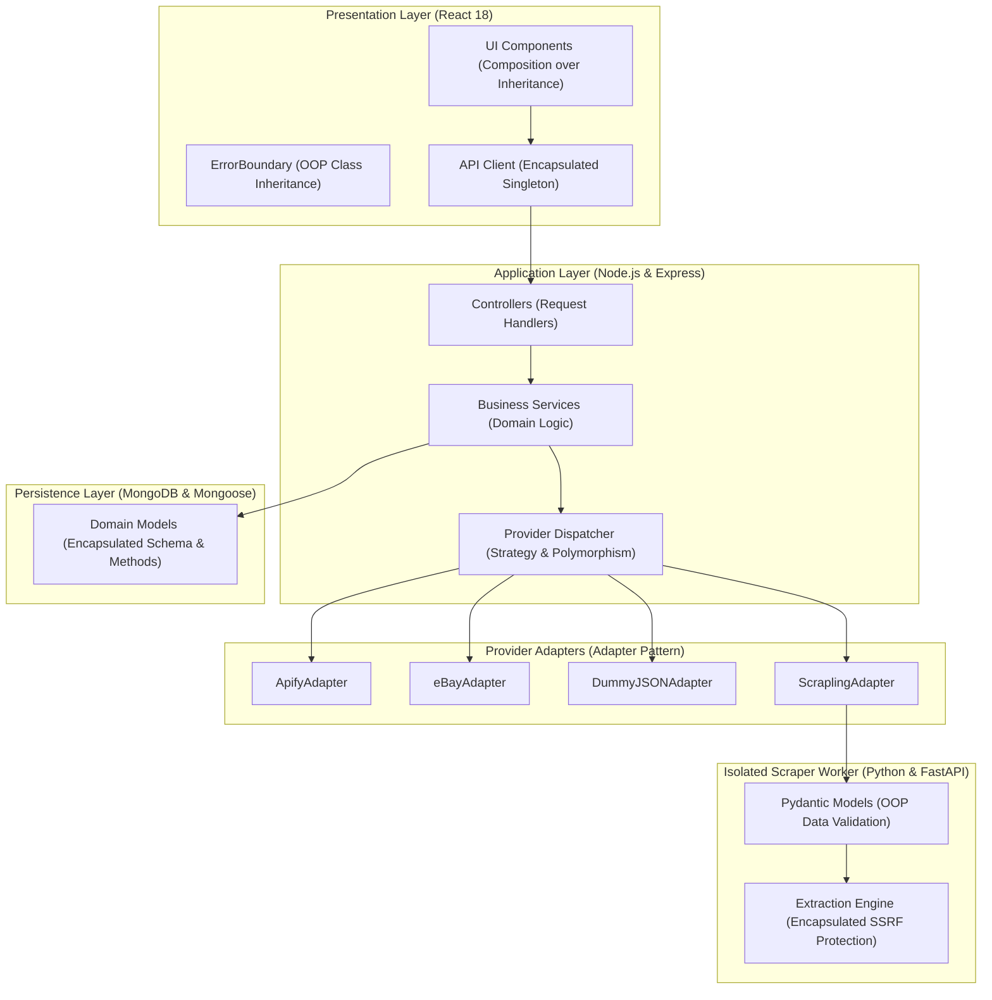

# Object-Oriented Programming (OOP) Concepts in PriceRadar

> **Comprehensive Technical Guide & Viva Preparation Manual**  
> *Author:* PriceRadar Engineering Team  
> *Repository:* [https://github.com/VamshiYamjala/PriceR](https://github.com/VamshiYamjala/PriceR)  
> *Target Audience:* Software Engineers, College Evaluators, Technical Interviewers, and Project Reviewers

---

## 1. Architectural Overview & Paradigm Blending

PriceRadar is an enterprise-grade multi-retailer price tracker built using a modern **multi-paradigm software architecture**. Rather than forcing a pure, rigid class hierarchy across every file, PriceRadar strategically blends:

1. **Object-Oriented Programming (OOP)**: For domain models, entity state encapsulation, scraper adapters, error hierarchies, and structured data-transfer objects (DTOs).
2. **Component-Driven Architecture (Composition)**: In React for modular UI building blocks and interface lifecycle management.
3. **Functional Programming (FP)**: For stateless utility calculations, immutable data pipelines, and Express middleware composition.
4. **Service-Oriented / Layered Architecture**: For strict separation of concerns between controllers, business services, database access layers, and external hardware/network I/O.



---

## 2. The Four Pillars of OOP in PriceRadar

The four core pillars of Object-Oriented Programming—**Encapsulation**, **Abstraction**, **Inheritance**, and **Polymorphism**—are implemented throughout the project.

---

### Pillar 1: Encapsulation

Encapsulation bundles data (attributes) and behaviors (methods) together into a single unit while restricting direct external access to internal state to prevent unauthorized mutation or security leakage.

#### A. Database Schema and Sensitive Field Encapsulation (`server/src/models/User.js`)
In the `User` domain model, user credentials and sensitive hashes must never leak into memory, database queries, or network JSON payloads.

```javascript
// File: server/src/models/User.js (Lines 19-26)
passwordHash: {
  type: String,
  required: true,
  // ENCAPSULATION: Never select this field by default so a stray
  // User.find() or User.findById() elsewhere cannot accidentally leak hashes.
  // Explicitly requires `.select('+passwordHash')` only in auth verification routines.
  select: false,
}
```

#### B. Instance Method Encapsulation (`server/src/models/MonitorRun.js`)
Instead of allowing external services to directly inspect internal MongoDB metadata, `MonitorRun` exposes an encapsulated instance method `toPublicJSON()` that sanitizes output and formats internal dates and arrays safely.

```javascript
// File: server/src/models/MonitorRun.js (Lines 74-94)
monitorRunSchema.methods.toPublicJSON = function () {
  return {
    runId: this._id.toString(),
    status: this.status,
    triggeredBy: this.triggeredBy,
    startedAt: this.startedAt ? this.startedAt.toISOString() : null,
    completedAt: this.completedAt ? this.completedAt.toISOString() : null,
    durationMs: this.durationMs,
    offersAttempted: this.offersAttempted,
    offersSuccessful: this.offersSuccessful,
    offersFailed: this.offersFailed,
    triggeredAlerts: this.triggeredAlerts,
    errorsCount: this.errors ? this.errors.length : 0,
    errors: (this.errors || []).map((e) => ({
      offerId: e.offerId ? e.offerId.toString() : null,
      provider: e.provider || null,
      message: e.message || null,
    })),
    failureReason: this.failureReason,
  };
};
```

#### C. Strong Type & State Encapsulation in Python (`worker/main.py`)
In the Python Scrapling worker, incoming and outgoing HTTP request payloads are encapsulated inside Pydantic classes inheriting from `BaseModel`.

```python
# File: worker/main.py (Lines 24-41)
class ExtractRequest(BaseModel):
    url: str
    currency: Optional[str] = "GBP"

class ExtractResponse(BaseModel):
    success: bool
    url: str
    title: Optional[str] = None
    price_in_paise: Optional[int] = None
    original_price: Optional[float] = None
    original_currency: Optional[str] = None
    currency: Optional[str] = "INR"
    availability: Optional[str] = "unknown"
    image_url: Optional[str] = None
    data_status: str = "sample"
    retrieved_at: str
    error: Optional[str] = None
```
**Why this matters:** Data entering the worker cannot violate domain invariants. Bad URLs, negative prices, or missing timestamps are stopped before executing network operations.

---

### Pillar 2: Abstraction

Abstraction hides complex background implementation details and presents only a clean, simple, understandable interface to the consumer.

#### A. The Provider Scraper Abstraction (`server/src/providers/index.js`)
When the background monitoring cycle (`priceMonitor.js`) refreshes prices for 50 different items across Amazon, Flipkart, eBay, Apify, and DummyJSON, it **never** writes retailer-specific scraping logic, Cheerio selectors, or OAuth API headers.

Instead, the monitoring engine depends on a single high-level abstraction:

```javascript
// File: server/src/providers/index.js
export async function fetchOffer(offer) {
  // Complex retailer logic, Puppeteer sessions, API rate limits, 
  // and error fallbacks are hidden behind this single abstract function.
  let result;
  if (offer.provider === 'apify') {
    result = await apifyProvider.fetchOffer(offer);
  } else if (offer.provider === 'ebay') {
    result = await ebayProvider.fetchOffer(offer);
  } else if (offer.provider === 'dummyjson') {
    result = await dummyjsonProvider.fetchOffer(offer);
  } else if (offer.provider === 'scrapling') {
    result = await scraplingProvider.fetchOffer(offer);
  } else {
    result = await fixtureProvider.fetchOffer(offer);
  }

  // Consistent abstraction: All providers return normalized timestamp and paise currency
  return {
    ...result,
    fetchedAt: new Date().toISOString(),
  };
}
```

#### B. Currency & Integer Arithmetic Abstraction (`server/src/utils/money.js`)
JavaScript handles numbers as IEEE 754 floating-point decimals, where calculations like `0.1 + 0.2 === 0.30000000000000004` cause rounding errors in price alerts. PriceRadar abstracts all monetary calculations into integer paise:

```javascript
// File: server/src/utils/money.js
export function toPaise(rupees) {
  if (typeof rupees !== 'number' || isNaN(rupees)) return null;
  return Math.round(rupees * 100);
}

export function toRupees(paise) {
  if (typeof paise !== 'number' || isNaN(paise)) return null;
  return Number((paise / 100).toFixed(2));
}
```
**Benefit:** The alert evaluator (`alertEvaluator.js`) can execute clean integer comparisons (`currentPriceInPaise <= targetPriceInPaise`) without worrying about floating-point precision issues.

---

### Pillar 3: Inheritance

Inheritance allows a new class or module to absorb fields, methods, and behaviors from an existing parent class, promoting code reuse, polymorphic handling, and extensibility.

#### A. Class-Based React Error Boundary (`client/src/components/ErrorBoundary.jsx`)
In modern React, while functional components handle standard views, **Error Boundaries require classical Object-Oriented inheritance** using ES6 `class ... extends React.Component`.

```javascript
// File: client/src/components/ErrorBoundary.jsx (Lines 4-24)
export default class ErrorBoundary extends React.Component {
  constructor(props) {
    super(props); // Calls parent class (React.Component) constructor
    this.state = { hasError: false, error: null };
  }

  // Static lifecycle method overridden from React.Component
  static getDerivedStateFromError(error) {
    return { hasError: true, error };
  }

  // Instance method overridden from React.Component
  componentDidCatch(error, errorInfo) {
    console.error('[ErrorBoundary] Caught render error:', error, errorInfo);
  }

  render() {
    if (this.state.hasError) {
      return (
        <div className="container py-5 text-center">
          <h2>Display Notice</h2>
          <p>We encountered a display issue while rendering this section.</p>
        </div>
      );
    }
    return this.props.children;
  }
}
```
**OOP Mechanisms Demonstrated:**
1. `extends React.Component`: Establishes the parent-child inheritance chain.
2. `super(props)`: Delegates initialization of state and properties to the superclass.
3. Method Overriding (`componentDidCatch`): Replaces base framework behavior with custom application logging.

#### B. Pydantic Model Inheritance in Python Scraper (`worker/main.py`)
Both `ExtractRequest` and `ExtractResponse` inherit from Pydantic's `BaseModel`:

```python
from pydantic import BaseModel

class ExtractRequest(BaseModel):
    url: str
    currency: Optional[str] = "GBP"
```
By inheriting from `BaseModel`, `ExtractRequest` automatically gains:
- JSON schema auto-generation.
- Automatic runtime type validation and deserialization.
- Methods such as `.dict()`, `.json()`, and `.copy()`.

---

### Pillar 4: Polymorphism

Polymorphism ("many forms") allows different classes or modules to be manipulated through the identical unified interface, with each specific module executing its own customized behavior.

#### Dynamic Provider Polymorphism
In PriceRadar, each retailer scraper has fundamentally different requirements:
- **eBay**: Authenticates with an OAuth 2.0 Bearer token and calls the eBay Browse REST API.
- **Apify**: Initiates cloud actor tasks and polls dataset webhooks for Amazon/Flipkart data.
- **Scrapling**: Dispatches requests through a local Python FastAPI worker with SSRF protection.
- **DummyJSON**: Interacts with mock e-commerce REST testbeds.

Despite these internal differences, every provider module satisfies the exact same polymorphic contract:

$$\text{fetchOffer}(\text{offer}) \rightarrow \text{Promise}\langle\text{NormalizedResult}\rangle$$

| Provider File | Specific Internal Logic | Unified Return Interface |
| :--- | :--- | :--- |
| `server/src/providers/ebay.js` | OAuth 2.0 Bearer Token, Browse API JSON | `{ success, priceInPaise, availability, ... }` |
| `server/src/providers/apify.js` | Webhook polling, Actor dataset extraction | `{ success, priceInPaise, availability, ... }` |
| `server/src/providers/scrapling.js` | HTTP call to Python worker on port 8000 | `{ success, priceInPaise, availability, ... }` |
| `server/src/providers/dummyjson.js` | Testbed REST endpoint, static currency | `{ success, priceInPaise, availability, ... }` |

When `priceMonitor.js` runs:

```javascript
// File: server/src/services/priceMonitor.js
for (const offer of activeOffers) {
  // POLYMORPHISM IN ACTION:
  // The monitor does not care whether 'offer' is eBay, Apify, or Scrapling.
  // It simply calls the polymorphic dispatcher.
  const freshData = await fetchOffer(offer);
  
  // Standardized processing across all providers
  if (freshData.success && freshData.priceInPaise) {
    await updateOfferPrice(offer._id, freshData.priceInPaise);
  }
}
```

---

## 3. Design Patterns Applied in PriceRadar

| Design Pattern | Category | Where It Is Used in PriceRadar | Purpose / Benefit |
| :--- | :--- | :--- | :--- |
| **Adapter Pattern** | Structural | `server/src/providers/*.js` | Wraps heterogeneous third-party APIs (eBay, Apify, Python Scrapling) to match PriceRadar's internal `Offer` contract. |
| **Strategy Pattern** | Behavioral | `server/src/providers/index.js` | Dynamically selects the collection strategy at runtime based on the `offer.provider` attribute. |
| **Singleton Pattern** | Creational | `server/src/config/db.js`, `api.js` | Guarantees a single database connection pool and a single configured Axios client across the entire application lifecycle. |
| **Factory Method** | Creational | `server/src/services/alertDispatcher.js` | Instantiates and routes alert notifications to the appropriate channel handler (Brevo Email vs Telegram Bot). |
| **Distributed Lock** | Concurrency | `server/src/models/DistributedLock.js` | Uses database atomic locking to prevent multiple overlapping monitoring runs across clustered server instances. |
| **Observer Pattern** | Behavioral | `server/src/services/alertEvaluator.js` | Listens to price shifts and notifies subscribed channels (Email/Telegram) when alert conditions trigger. |

---

### Detailed Pattern Breakdowns

#### 1. The Adapter Pattern
The Adapter pattern allows incompatible interfaces to collaborate. eBay returns an object like:
```json
{
  "itemSummaries": [{ "price": { "value": "299.99", "currency": "USD" } }]
}
```
While DummyJSON returns:
```json
{
  "price": 299,
  "discountPercentage": 12.5
}
```
The adapter functions in `server/src/providers/ebay.js` and `server/src/providers/dummyjson.js` convert these completely incompatible response payloads into PriceRadar's unified domain model:
```javascript
{
  success: true,
  provider: "ebay",
  priceInPaise: 2489917,
  availability: "in_stock",
  fetchedAt: "2026-10-25T13:15:00.000Z"
}
```

#### 2. The Singleton Pattern
The application must maintain exactly **one** open connection pool to MongoDB Atlas to prevent socket leaks, database connection exhaustion, and memory consumption.

```javascript
// File: server/src/config/db.js
let isConnected = false;

export async function connectDB() {
  // SINGLETON PATTERN: Return existing connection if already established
  if (isConnected && mongoose.connection.readyState === 1) {
    return mongoose.connection;
  }

  const conn = await mongoose.connect(process.env.MONGODB_URI, {
    maxPoolSize: 10,
    serverSelectionTimeoutMS: 5000,
  });

  isConnected = true;
  return conn;
}
```

Similarly, in the React frontend, `client/src/services/api.js` instantiates and exports a **single configured Axios instance** with standard baseURL, timeout, and request/response interceptors.

---

## 4. SOLID Principles in PriceRadar

The SOLID principles guide maintainable, scalable Object-Oriented design:

### 1. Single Responsibility Principle (SRP)
*Every class, module, or function should have only one reason to change.*
- **Controllers** (`authController.js`, `alertsController.js`): Only handle HTTP requests, input validation, and HTTP status responses.
- **Services** (`priceMonitor.js`, `alertEvaluator.js`): Only contain core business calculations, price comparison rules, and scheduling coordination.
- **Providers** (`ebay.js`, `apify.js`): Only handle communication with a specific external retailer.
- **Models** (`Alert.js`, `User.js`): Only define data structure, indexing, and persistence constraints.

### 2. Open/Closed Principle (OCP)
*Software entities should be open for extension, but closed for modification.*
- If PriceRadar wants to add **Croma**, **Reliance Digital**, or **Walmart** as new monitored retailers:
  - We do **not** modify `alertEvaluator.js`, `priceMonitor.js`, or `alertsController.js`.
  - We simply create a new adapter file: `server/src/providers/croma.js`.
  - We register it in `server/src/providers/index.js`.
  - The rest of the system immediately works with the new retailer without rewriting any existing monitoring code.

### 3. Liskov Substitution Principle (LSP)
*Subtypes must be substitutable for their base types without altering program correctness.*
- Any retailer adapter in `server/src/providers/` can replace any other. If `priceMonitor.js` switches an offer from `scrapling` to `dummyjson` or `apify`, the monitoring engine does not crash or require custom `if-else` branches because every adapter adheres to the same return signature.

### 4. Interface Segregation Principle (ISP)
*Clients should not be forced to depend on methods they do not use.*
- In the Python Scrapling worker, `ExtractRequest` only requires `url` and optional `currency`. It does not require user IDs, alert configurations, or database connection strings.
- In the client API service (`client/src/services/api.js`), endpoints are divided into clear, specialized helper functions (`getWatchlist()`, `createAlert()`, `verifyResetOtp()`) rather than a monolithic do-everything API handler.

### 5. Dependency Inversion Principle (DIP)
*High-level modules should not depend on low-level modules; both should depend on abstractions.*
- The `priceMonitor.js` service (high-level domain logic) does not directly import `requests` or `axios` to execute raw eBay API calls (low-level network I/O).
- Instead, it depends on the abstract provider interface exposed by `providers/index.js`.

---

## 5. Composition vs. Inheritance in PriceRadar

A fundamental principle of modern software engineering is:
> *"Favor object composition over class inheritance."*

While inheritance creates tight coupling between superclasses and subclasses, PriceRadar emphasizes **Composition** where appropriate:

### A. React Component Composition (`client/src/pages/DashboardPage.jsx`)
Rather than creating deep inheritance hierarchies (`BasePage -> AuthenticatedPage -> DashboardPage`), PriceRadar uses **component composition**:

```jsx
// File: client/src/pages/DashboardPage.jsx
<div className="container py-4">
  <div className="row g-4">
    {/* Composed Navigation Component */}
    <div className="col-12 col-lg-3">
      <InternalSidebar />
    </div>

    {/* Composed Content Component */}
    <div className="col-12 col-lg-9">
      <DashboardMetrics watchlist={watchlist} alerts={alerts} />
      <RecentWatchlist items={watchlist} />
      <ConfiguredAlerts alerts={alerts} />
    </div>
  </div>
</div>
```

### B. Mongoose Embedded Document Composition (`server/src/models/MonitorRun.js`)
Instead of inheriting errors from a generic log table, the `MonitorRun` schema composes an array of structured error sub-documents directly within itself:

```javascript
// File: server/src/models/MonitorRun.js
errors: [
  {
    offerId: { type: mongoose.Schema.Types.ObjectId, ref: 'Offer' },
    provider: { type: String },
    message: { type: String },
  },
]
```

---

## 6. Viva & Technical Interview Questions & Answers

Use this section to prepare for college project reviews, viva voce examinations, and technical interviews.

---

### Q1: Where is Object-Oriented Programming used in PriceRadar if JavaScript is primarily prototype-based?
**Answer:**  
In JavaScript, OOP is implemented using ES6 `class` syntax, constructor functions, and prototype-based object models. In PriceRadar:
1. `ErrorBoundary` (`client/src/components/ErrorBoundary.jsx`) explicitly extends `React.Component`, utilizing constructor initialization, `super(props)`, state encapsulation, and method overriding (`componentDidCatch`).
2. Mongoose models (`User.js`, `MonitorRun.js`, `Alert.js`) encapsulate database schemas, validation rules, and instance methods (`toPublicJSON()`).
3. The scraper worker in Python (`worker/main.py`) defines strongly-typed data transfer classes using Pydantic's `BaseModel` inheritance.
4. Provider modules follow OOP architectural design patterns (Adapter, Strategy, and Singleton).

---

### Q2: How is the Adapter Pattern implemented in the retailer integrations?
**Answer:**  
PriceRadar collects product prices from disparate sources: eBay (REST Browse API), Apify (cloud scraper datasets), Scrapling (local Python worker), and DummyJSON (mock store). Each provider returns completely different JSON field names, data types, and currency formats.  
We implemented the **Adapter Pattern** across `server/src/providers/` (`ebay.js`, `apify.js`, `scrapling.js`, etc.). Each adapter translates its specific provider's payload into PriceRadar's unified `Offer` contract containing normalized `priceInPaise`, `availability`, and `fetchedAt`.

---

### Q3: How does PriceRadar achieve Polymorphism?
**Answer:**  
Polymorphism is demonstrated through the `fetchOffer(offer)` dispatcher in `server/src/providers/index.js`. The monitoring engine (`priceMonitor.js`) iterates through a list of diverse offers and invokes `fetchOffer(offer)` without needing to know which retailer backend is being queried. Each provider implements the identical method signature, executing its own custom extraction logic polymorphically.

---

### Q4: How is Encapsulation used for system security?
**Answer:**  
Encapsulation is used in multiple security layers:
1. **Password Hash Protection**: In `server/src/models/User.js`, `passwordHash` has `select: false`. Standard database queries cannot retrieve or leak the hash unless explicitly opted in with `.select('+passwordHash')`.
2. **OTP Challenge Protection**: In `OtpChallenge.js`, OTPs and reset tokens are never stored in plaintext; only their SHA-256 hashes are encapsulated in the database.
3. **Data Sanitization**: In `MonitorRun.js`, internal server IDs and raw stack traces are encapsulated and filtered through the `toPublicJSON()` instance method before reaching the API response.

---

### Q5: What is the benefit of the Singleton pattern in `db.js`?
**Answer:**  
In serverless or Node.js runtime environments, unmanaged database calls can instantiate hundreds of redundant connection sockets, exhausting MongoDB connection limits. By implementing the **Singleton Pattern** in `server/src/config/db.js`, PriceRadar checks `mongoose.connection.readyState === 1` and reuses the existing active connection pool, ensuring optimal resource utilization and preventing memory leaks.

---

### Q6: How does the project demonstrate the Open/Closed Principle (OCP)?
**Answer:**  
The provider architecture is open for extension but closed for modification. If we need to support a new marketplace like Amazon India or Flipkart live scrapers, we do not touch the core alert evaluator or the monitoring scheduler. We simply add a new adapter file in `server/src/providers/` that conforms to the standard provider interface and register it in the dispatcher.

---

### Q7: Why does PriceRadar favor Composition over Inheritance in React and Express?
**Answer:**  
Deep inheritance trees in UI and web servers lead to the "fragile base class problem" where changes to a parent class unintentionally break downstream subclasses. By favoring **Composition**:
- In React, complex layouts are created by nesting small, focused components (`<InternalSidebar />`, `<MetricCard />`).
- In Express, functionality is composed using modular middleware pipelines (`requireAuth`, `asyncHandler`, input validators) rather than subclassing request handlers.

---

## 7. Code Mapping Summary Table

| OOP / Design Concept | Exact File Location | Code Symbol / Construct |
| :--- | :--- | :--- |
| **Class Inheritance** | `client/src/components/ErrorBoundary.jsx` | `class ErrorBoundary extends React.Component` |
| **Model Inheritance** | `worker/main.py` | `class ExtractRequest(BaseModel)` |
| **Data Encapsulation** | `server/src/models/User.js` | `passwordHash: { select: false }` |
| **Method Encapsulation** | `server/src/models/MonitorRun.js` | `monitorRunSchema.methods.toPublicJSON` |
| **Adapter Pattern** | `server/src/providers/ebay.js`, `apify.js` | `export async function fetchOffer(offer)` |
| **Strategy Pattern** | `server/src/providers/index.js` | `export async function fetchOffer(offer)` |
| **Singleton Pattern** | `server/src/config/db.js` | `connectDB()` connection cache check |
| **Factory / Dispatcher** | `server/src/services/alertDispatcher.js` | `dispatchAlert()` (Email vs Telegram routing) |
| **Observer Pattern** | `server/src/services/alertEvaluator.js` | Price drop trigger $\rightarrow$ notification dispatch |
| **Abstraction** | `server/src/utils/money.js` | `toPaise()`, `toRupees()` integer abstraction |
| **Component Composition** | `client/src/pages/DashboardPage.jsx` | Composited layout with `<InternalSidebar />` |
