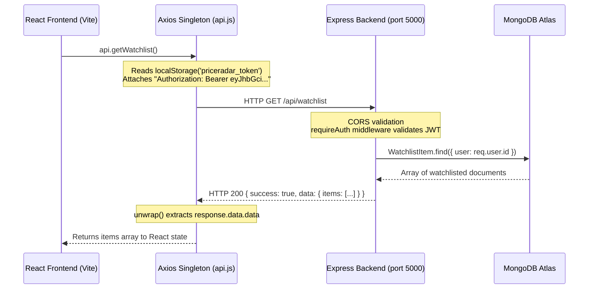
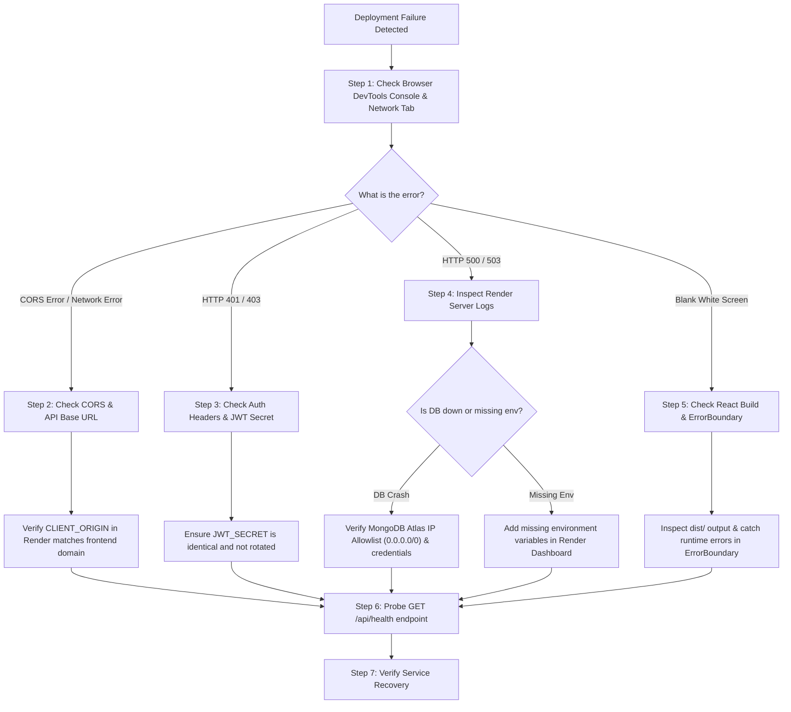

# PriceRadar — Project Review & Viva Voce Interview Preparation Guide

> **Focus:** Core Web Fundamentals, React Hooks, Node.js & Express, Client-Server Communication, and Production Deployment Troubleshooting  
> **Project:** PriceRadar (Multi-Retailer Price Tracking & Alert Engine)  
> **Repository:** [https://github.com/VamshiYamjala/PriceR](https://github.com/VamshiYamjala/PriceR)  
> **Target Audience:** College Viva Voce, Academic Project Reviews, Technical Hiring Interviews  

---

## Table of Contents
1. [Core Web Concepts: API & REST API](#1-core-web-concepts-api--rest-api)
2. [Frontend Architecture: React 18 & Vite](#2-frontend-architecture-react-18--vite)
3. [React Hooks: Deep Dive with Code Snippets](#3-react-hooks-deep-dive-with-code-snippets)
4. [Backend Engineering: Node.js & Express.js](#4-backend-engineering-nodejs--expressjs)
5. [Understanding Middleware in Express](#5-understanding-middleware-in-express)
6. [Connecting Frontend and Backend (Client-Server Communication)](#6-connecting-frontend-and-backend)
7. [Production Troubleshooting: "What will you do when the project does not work after deploying?"](#7-production-troubleshooting)
8. [Quick-Fire Viva Voce Rapid Questions](#8-quick-fire-viva-voce-rapid-questions)

---

## 1. Core Web Concepts: API & REST API

### What is an API?
**Simple Definition:**  
**API** stands for **Application Programming Interface**. It is a software intermediary that allows two separate applications or systems to communicate and exchange data without needing to understand each other's internal source code or database.

**Real-World Analogy (The Restaurant Waiter):**
- **You (The Client/Frontend):** Sitting at the dining table, looking at the menu.
- **The Kitchen (The Server/Backend/Database):** Where food is prepared and stored.
- **The Waiter (The API):** Takes your order from the table, carries it to the kitchen, and delivers the prepared food back to your table. You do not need to enter the kitchen or cook the food yourself.

**How APIs are used in PriceRadar:**
1. **Internal API:** The React frontend communicates with our Node.js backend using endpoints like `GET /api/watchlist` and `POST /api/alerts`.
2. **External Ingestion APIs:** Our backend calls third-party APIs:
   - **eBay Browse API:** To fetch live auction and "Buy It Now" pricing.
   - **Apify API v2:** To run cloud web scrapers for Amazon India and Flipkart.
3. **Notification APIs:** Our server calls the **Brevo API** to send transactional emails and the **Telegram Bot API** to push instant alerts to mobile chats.

---

### What is a REST API?
**Definition:**  
A **REST API** (Representational State Transfer API) is an architectural style for building network applications based on standard web protocols (HTTP/HTTPS) and stateless client-server interactions.

#### Core Principles of REST:
1. **Statelessness:** The server does not store user session state between requests. Every single request must include all information needed to process it (e.g., JWT token in the `Authorization` header).
2. **Client-Server Separation:** The user interface (React SPA) and data storage (Express + MongoDB) are completely independent and communicate only via JSON payloads.
3. **Resource-Oriented URLs:** Endpoints represent nouns/resources rather than verbs:
   - ✅ `GET /api/alerts` (retrieve alerts)
   - ✅ `POST /api/alerts` (create a new alert)
   - ✅ `DELETE /api/alerts/:id` (delete a specific alert)
   - ❌ `GET /api/getAlerts` or `POST /api/deleteAlert` (non-RESTful anti-patterns)
4. **Standard HTTP Methods:**
   - **`GET`**: Retrieve resources (read-only, idempotent).
   - **`POST`**: Create a new resource or initiate an operation.
   - **`PUT` / `PATCH`**: Update an existing resource.
   - **`DELETE`**: Remove a resource.

#### Standard HTTP Status Codes in PriceRadar:
| Status Code | Meaning | Example from PriceRadar |
| :--- | :--- | :--- |
| **`200 OK`** | Request succeeded | `GET /api/products` returns matching items |
| **`201 Created`** | Resource successfully created | `POST /api/alerts` creates a price alert rule |
| **`202 Accepted`** | Task accepted for background execution | `POST /api/monitor/run` starts async scrape cycle |
| **`400 Bad Request`** | Validation error / invalid client payload | Short password (< 8 chars) or malformed email |
| **`401 Unauthorized`** | Missing or invalid authentication token | Calling protected routes without `Bearer <token>` |
| **`403 Forbidden`** | Authenticated user lacks permission | Regular user attempting to access admin diagnostics |
| **`404 Not Found`** | Resource does not exist | `GET /api/products/non-existent-id` |
| **`409 Conflict`** | Duplicate or overlapping state | Monitoring trigger when a cycle is already running |
| **`429 Too Many Requests`** | Rate limit throttled | Entering incorrect OTP 5 times consecutively |
| **`500 Internal Error`** | Unhandled server exception | Database cluster crash or internal bug |
| **`503 Service Unavailable`** | Service temporarily down | Database connection unreachable during startup |

---

## 2. Frontend Architecture: React 18 & Vite

### What is React?
**Definition:**  
React is an open-source, component-driven JavaScript library developed by Meta (Facebook) for building dynamic, interactive user interfaces.

#### Key Features of React:
1. **Component-Based:** The UI is broken down into small, reusable, independent pieces (e.g., `<Navbar />`, `<ProductCard />`, `<InternalSidebar />`, `<MetricCard />`).
2. **Declarative Programming:** Instead of telling the browser how to manipulate the DOM step-by-step (imperative DOM manipulation like `document.getElementById().innerHTML = ...`), you declare **what the UI should look like based on the current state**, and React updates the DOM automatically.
3. **Virtual DOM (VDOM):** React keeps a lightweight virtual representation of the real browser DOM in memory. When state changes:
   - React creates a new Virtual DOM tree.
   - Performs a "diffing" algorithm to compare the new VDOM with the previous VDOM.
   - Computes the minimum number of changes required (reconciliation).
   - Batches and applies only those specific changes to the real browser DOM, avoiding expensive layout reflows.
4. **Single-Page Application (SPA):** The browser loads a single `index.html` file once. When the user navigates to `/dashboard` or `/watchlist`, React Router intercepts the URL change and swaps components dynamically in JavaScript without reloading the entire web page.

### Why did you use Vite instead of Create React App (CRA)?
- **Create React App (CRA)** is deprecated by Meta. It used Webpack, which bundles the entire application before starting the dev server, resulting in slow startup times (30–60 seconds on large apps).
- **Vite** leverages native **Browser ES Modules (ESM)** and pre-bundles dependencies using **`esbuild`** (written in Go, 10–100x faster than JavaScript-based bundlers).
- In PriceRadar, Vite starts the development server in **< 300ms** and compiles our entire production bundle in **< 900ms**.

---

## 3. React Hooks: Deep Dive with Code Snippets

### What are React Hooks?
**Definition:**  
React Hooks are built-in functions introduced in React 16.8 that allow functional components to have state, manage lifecycles, access context, and interact with the DOM without writing ES6 class components.

#### The Rules of Hooks:
1. **Only call hooks at the top level:** Do not call hooks inside loops, conditions (`if`), or nested functions.
2. **Only call hooks from React function components or custom hooks:** Do not call them from standard vanilla JavaScript utility functions.

---

### 1. `useState` (State Management)
**What it does:** Allows a functional component to store and update local, reactive state across re-renders. When state changes via its setter function, React re-renders the component.

**Syntax:**
```javascript
const [state, setState] = useState(initialValue);
```

**Where and How we used it in PriceRadar:**
In [`client/src/pages/LoginPage.jsx`](file:///d:/priceR/client/src/pages/LoginPage.jsx#L11-L15):
```javascript
export default function LoginPage() {
  // useState manages user input fields, error messages, and loading spinners
  const [email, setEmail] = useState('');
  const [password, setPassword] = useState('');
  const [error, setError] = useState(null);
  const [loading, setLoading] = useState(false);

  async function handleSubmit(e) {
    e.preventDefault();
    setLoading(true); // Triggers re-render: button shows "Signing in…" spinner
    try {
      await login({ email, password });
    } catch (err) {
      setError(err.message); // Triggers re-render: renders red alert banner
    } finally {
      setLoading(false);
    }
  }
  // ...
}
```

---

### 2. `useEffect` (Side Effects & Lifecycle)
**What it does:** Performs side effects in functional components, such as data fetching, subscribing to timers, interacting with browser storage, or manually mutating the DOM.

**The Dependency Array:**
- `useEffect(fn)`: Runs after **every** render (rarely used).
- `useEffect(fn, [])`: Runs **only once** when the component mounts (equivalent to `componentDidMount`).
- `useEffect(fn, [depA, depB])`: Runs on mount and re-runs **whenever `depA` or `depB` changes**.
- Returning a function from `useEffect`: Serves as a **cleanup function** (equivalent to `componentWillUnmount`).

**Where and How we used it in PriceRadar:**
In [`client/src/pages/DashboardPage.jsx`](file:///d:/priceR/client/src/pages/DashboardPage.jsx#L38-L44):
```javascript
export default function DashboardPage() {
  const { isAuthenticated } = useAuth();
  const [watchlist, setWatchlist] = useState([]);
  const [loading, setLoading] = useState(true);

  // SIDE EFFECT: Automatically fetches dashboard data when the user authenticates
  useEffect(() => {
    if (!isAuthenticated) {
      setLoading(false);
      return;
    }

    async function loadDashboardData() {
      try {
        const [wlData, alertsData] = await Promise.all([
          api.getWatchlist(),
          api.getAlerts()
        ]);
        setWatchlist(wlData?.items || []);
      } finally {
        setLoading(false);
      }
    }

    loadDashboardData();
  }, [isAuthenticated]); // Only re-runs if authentication status changes
  // ...
}
```

---

### 3. `useRef` (Mutable References & DOM Access)
**What it does:** Returns a mutable ref object whose `.current` property is initialized with the passed argument.
- **Key difference from `useState`:** Mutating `.current` **does NOT cause a component re-render**.
- Used for:
  1. Storing interval/timer IDs across renders.
  2. Directly accessing browser DOM elements (e.g. focusing an input or detecting outside clicks).

**Where and How we used it in PriceRadar:**
In [`client/src/pages/NotificationPreferencesPage.jsx`](file:///d:/priceR/client/src/pages/NotificationPreferencesPage.jsx#L18-L45):
```javascript
export default function NotificationPreferencesPage() {
  // useRef holds the background polling setInterval ID across renders
  const pollTimerRef = useRef(null);

  async function handleStartConnect() {
    const res = await api.getTelegramLinkCode();
    
    // Store timer in ref without triggering unnecessary UI re-renders
    pollTimerRef.current = setInterval(async () => {
      const pref = await api.getNotificationPreferences();
      if (pref?.telegramLinked) {
        clearInterval(pollTimerRef.current); // Stop polling when linked
      }
    }, 3000);
  }

  // CLEANUP: If the user navigates away, clear the timer to prevent memory leaks
  useEffect(() => {
    return () => {
      if (pollTimerRef.current) clearInterval(pollTimerRef.current);
    };
  }, []);
}
```

---

### 4. `useContext` (Global State & Avoiding Prop Drilling)
**What it does:** Allows components anywhere in the component tree to subscribe to and read context data without passing props manually through every intermediate parent (eliminating "prop drilling").

**Where and How we used it in PriceRadar:**
In [`client/src/context/AuthContext.jsx`](file:///d:/priceR/client/src/context/AuthContext.jsx):
```javascript
// 1. Create the Context object
const AuthContext = createContext(null);

// 2. Context Provider Component wrapping the entire application in App.jsx
export function AuthProvider({ children }) {
  const [token, setToken] = useState(() => localStorage.getItem('priceradar_token'));
  const [user, setUser] = useState(null);

  const login = async (credentials) => { /* ... */ };
  const logout = () => { /* ... */ };

  return (
    <AuthContext.Provider value={{ isAuthenticated: !!token, user, login, logout }}>
      {children}
    </AuthContext.Provider>
  );
}

// 3. Custom Hook consuming the context cleanly
export function useAuth() {
  return useContext(AuthContext);
}
```
Any component can now access authentication with a single line:
```javascript
const { user, isAuthenticated, logout } = useAuth();
```

---

### 5. React Router Hooks Used in PriceRadar
| Hook | Purpose in PriceRadar | Example File |
| :--- | :--- | :--- |
| **`useNavigate()`** | Programmatic navigation between routes after actions (e.g., redirecting to `/login` after password reset). | [`ForgotPasswordPage.jsx`](file:///d:/priceR/client/src/pages/ForgotPasswordPage.jsx) |
| **`useParams()`** | Extracts dynamic URL path parameters (e.g., `:productId` in `/products/:productId`). | [`ProductDetailPage.jsx`](file:///d:/priceR/client/src/pages/ProductDetailPage.jsx) |
| **`useSearchParams()`** | Reads and modifies query string parameters (e.g., `?q=laptop&category=electronics`). | [`SearchPage.jsx`](file:///d:/priceR/client/src/pages/SearchPage.jsx) |
| **`useLocation()`** | Inspects current pathname and access route state passed during redirects (`location.state.from`). | [`LoginPage.jsx`](file:///d:/priceR/client/src/pages/LoginPage.jsx) |

---

## 4. Backend Engineering: Node.js & Express.js

### What is Node.js?
**Definition:**  
Node.js is an open-source, cross-platform JavaScript runtime environment built on Google Chrome's **V8 JavaScript engine**. It executes JavaScript outside the web browser, allowing developers to write server-side applications in JavaScript.

#### How Node.js Works (The Event Loop):
- **Single-Threaded Event Loop:** Node.js runs on a single main thread using an event-driven architecture.
- **Non-Blocking Asynchronous I/O:** When Node.js performs a time-consuming task (such as reading from MongoDB Atlas, querying the eBay API, or dispatching an email via Brevo), it delegates the operation to the operating system kernel or background thread pool (libuv).
- Once the operation completes, a callback or Promise resolution is placed on the event queue, and the main thread picks it up.
- **Why it fits PriceRadar:** PriceRadar is an I/O-heavy system (calling scrapers, querying databases, sending webhooks). Node.js handles thousands of concurrent I/O operations with minimal memory consumption.

---

### What is Express.js?
**Definition:**  
Express.js is a minimalist, flexible web application framework for Node.js. While Node.js provides low-level HTTP primitives (`http.createServer()`), Express provides:
1. **Routing System:** Elegant mapping of HTTP verbs and URL paths to controller functions (`router.get('/products', productsController.getAll)`).
2. **Middleware Pipeline:** A structured chain to intercept, parse, authenticate, and validate requests.
3. **Request/Response Helpers:** Convenient utility methods (`res.status(200).json(...)`, `res.redirect()`, `req.params`, `req.body`).

---

## 5. Understanding Middleware in Express

### What is Middleware?
**Definition:**  
Middleware functions are functions that have access to the **Request object (`req`)**, the **Response object (`res`)**, and the **`next` function** in the application's request-response cycle.

```
Request ──> [Middleware 1] ──> [Middleware 2] ──> [Controller] ──> Response
```

A middleware function can:
1. Execute any code.
2. Modify the `req` or `res` objects (e.g. attaching `req.user = decodedUser`).
3. End the request-response cycle immediately (e.g. returning HTTP 401 Unauthorized).
4. Call `next()` to pass control to the next middleware in the pipeline.

---

### Key Middleware Implemented in PriceRadar:

#### 1. CORS Middleware (`server/src/app.js`)
Configured to enforce the browser's Same-Origin Policy and allow requests only from authorized domains:
```javascript
// File: server/src/app.js (Lines 25-38)
app.use(
  cors({
    origin: (origin, callback) => {
      // Allow requests with no origin (curl, server-to-server, Render health checks)
      if (!origin) return callback(null, true);
      if (allowedOrigins.includes(origin)) {
        return callback(null, true);
      }
      return callback(new Error(`CORS blocked for origin: ${origin}`));
    },
    credentials: true,
  })
);
```

#### 2. Body Parser Middleware (`express.json()`)
Built into Express; parses incoming HTTP requests with JSON payloads and populates `req.body`.

#### 3. Authentication Middleware (`server/src/middleware/auth.js`)
Intercepts incoming requests to protected routes, inspects the `Authorization` header, and verifies the JWT:
```javascript
// File: server/src/middleware/auth.js
export function requireAuth(req, res, next) {
  const authHeader = req.headers.authorization;
  if (!authHeader || !authHeader.startsWith('Bearer ')) {
    return res.status(401).json({
      success: false,
      error: { code: 'AUTH_REQUIRED', message: 'Authentication is required for this route.' },
    });
  }

  const token = authHeader.slice('Bearer '.length).trim();
  try {
    const payload = jwt.verify(token, process.env.JWT_SECRET);
    req.user = { id: payload.sub }; // Attach user identity to request object
    return next(); // Proceed to controller
  } catch (err) {
    return res.status(401).json({
      success: false,
      error: { code: 'AUTH_INVALID', message: 'Session is invalid or expired.' },
    });
  }
}
```

#### 4. Fast-Fail Database Health Guard (`server/src/app.js`)
Prevents requests from hanging for 10–30 seconds if MongoDB Atlas is unreachable:
```javascript
// File: server/src/app.js (Lines 58-65)
app.use('/api', (req, res, next) => {
  if (req.path === '/health' || req.path.startsWith('/diagnostics')) return next();
  if (process.env.NODE_ENV !== 'test' && mongoose.connection.readyState !== 1) {
    return res.status(503).json({
      success: false,
      error: { code: 'DATABASE_UNAVAILABLE', message: 'Database is currently unreachable.' },
    });
  }
  next();
});
```

#### 5. Global Error Handling Middleware (`server/src/middleware/errorHandler.js`)
Defined with four arguments: `(err, req, res, next)`. Any error thrown or passed to `next(err)` is caught here:
```javascript
export function errorHandler(err, req, res, next) {
  console.error('[Error]', err.message);
  const status = err.statusCode || 500;
  return res.status(status).json({
    success: false,
    error: {
      code: err.code || 'INTERNAL_ERROR',
      message: err.message || 'An unexpected server error occurred.',
    },
  });
}
```

---

## 6. Connecting Frontend and Backend

### How do the Frontend and Backend communicate?
The React frontend (client) and Express backend (server) are **completely decoupled applications** that can run on different ports, different servers, or even different continents.



### 1. Base URL Configuration
In [`client/src/services/api.js`](file:///d:/priceR/client/src/services/api.js):
```javascript
// In development: defaults to 'http://localhost:5000'
// In production: reads VITE_API_URL ('https://priceradar-api-02ib.onrender.com')
const rawBaseUrl = import.meta.env.VITE_API_URL || 'http://localhost:5000';
const apiBaseUrl = rawBaseUrl.replace(/\/+$/, '').replace(/\/api$/, '');

const api = axios.create({
  baseURL: apiBaseUrl,
});
```

### 2. Request Interceptor (JWT Transmission)
Every request automatically includes the user's credentials:
```javascript
api.interceptors.request.use((config) => {
  const token = localStorage.getItem('priceradar_token');
  if (token) {
    config.headers.Authorization = `Bearer ${token}`;
  }
  return config;
});
```

### 3. What is CORS and why does a CORS error happen?
- **CORS** stands for **Cross-Origin Resource Sharing**.
- Browsers have a built-in security feature called the **Same-Origin Policy (SOP)**. By default, JavaScript running on `http://localhost:5173` (Frontend) is **blocked** from reading responses from `http://localhost:5000` (Backend) because the port numbers differ (different origin).
- **The Fix:** The backend must explicitly send HTTP response headers giving permission:
  - `Access-Control-Allow-Origin: https://priceradar-web.onrender.com`
  - `Access-Control-Allow-Credentials: true`
  - `Access-Control-Allow-Headers: Authorization, Content-Type`
- When configured via the `cors()` package in `server/src/app.js`, the browser allows React to read data from Express seamlessly.

---

## 7. Production Troubleshooting

### Review Question: "What will you do when your project does not work after deploying?"

This is one of the most frequently asked questions in project defenses. Evaluators want to test whether you know **systematic debugging methodology** or if you just panic and guess.

#### Your Answer (Step-by-Step Diagnostic Framework):

> *"If the project does not work after deployment, I follow a systematic 7-step diagnostic workflow across the client, server, network, and database layers:"*



---

### Detailed Breakdown of the 7 Diagnostic Steps:

#### Step 1: Inspect Client-Side Browser DevTools (F12)
1. **Console Tab:**
   - Look for unhandled JavaScript errors or failed module imports (`Uncaught TypeError`, `ChunkLoadError`).
   - Check if our React `<ErrorBoundary />` rendered a fallback display notice.
2. **Network Tab:**
   - Filter by **Fetch/XHR** requests.
   - Inspect the failed HTTP request:
     - Is the request URL pointing to the production backend (`https://priceradar-api-02ib.onrender.com`) or did it mistakenly attempt to call `localhost:5000`?
     - What is the HTTP status code (401, 404, 500, 503)?
     - Check the **Response payload** to see the structured error: `{ success: false, error: { code, message } }`.

#### Step 2: Check for CORS & Mixed Content Issues
- If the browser console shows:  
  `Access to fetch at '...' from origin '...' has been blocked by CORS policy`
- **Diagnosis:** The backend `CLIENT_ORIGIN` environment variable does not match the frontend production URL.
- **Solution:** In Render Dashboard $\rightarrow$ Backend Environment $\rightarrow$ update `CLIENT_ORIGIN` to `https://priceradar-web.onrender.com` (no trailing slash).
- **Mixed Content Check:** Verify that the frontend is on HTTPS and all API calls use `https://`. Calling an `http://` backend from an `https://` frontend is blocked by modern browsers.

#### Step 3: Inspect Render Server Logs (Backend Runtime)
1. Open the **Render Dashboard** $\rightarrow$ select `priceradar-api-02ib` $\rightarrow$ **Logs**.
2. Look for server startup failures:
   - `SyntaxError` or missing package import.
   - `MongoServerSelectionError` / `MongooseServerSelectionError`: Indicates the backend cannot connect to MongoDB Atlas.
   - Unhandled Promise rejections or memory limit crashes (`Out of Memory - SIGKILL`).

#### Step 4: Verify MongoDB Atlas Connectivity
1. **Network Access / IP Allowlist:**
   - Cloud platforms like Render use dynamic IP addresses. If MongoDB Atlas has only whitelisted your home Wi-Fi IP address, Render cannot connect.
   - **Fix:** In MongoDB Atlas $\rightarrow$ **Network Access** $\rightarrow$ ensure `0.0.0.0/0` (Allow access from anywhere) is configured.
2. **Database Connection URI:**
   - Check if `MONGODB_URI` contains special characters in the password that were not URL-encoded (e.g. `@` or `#` breaking the URI string).

#### Step 5: Verify Environment Variables & Secrets
- Many deployment bugs happen because developers configure `.env` on their laptop but forget to set the corresponding environment variables in the cloud dashboard.
- Verify in Render Dashboard:
  - `NODE_ENV=production`
  - `MONGODB_URI`
  - `JWT_SECRET`
  - `CLIENT_ORIGIN`
  - `APIFY_API_TOKEN`
  - `MONITOR_TRIGGER_SECRET`

#### Step 6: Probe the Public Health Endpoint (`/api/health`)
- Open `https://priceradar-api-02ib.onrender.com/api/health` directly in the browser:
  - If it returns `{ "status": "ok", "database": "connected" }` $\rightarrow$ The server and database are healthy; the issue is on the client or network routing.
  - If it returns `503 Service Unavailable` $\rightarrow$ Node.js is running, but the database connection is down.
  - If it hangs indefinitely or returns `502 Bad Gateway` $\rightarrow$ The Node.js application is crashing on startup or failing health probes.

#### Step 7: Handle Free-Tier Cold Starts vs Real Crashes
- On Render's free tier, backend instances spin down (sleep) after 15 minutes of inactivity.
- The first request to a sleeping server can take **40–50 seconds** to wake up.
- **How PriceRadar handles this:**
  - Our frontend displays clear loading spinners and friendly retry prompts.
  - Our GitHub Actions monitoring workflow explicitly pings `/api/health` with bounded exponential retries (`--retry 6 --retry-delay 5`) to wake the server before executing monitoring triggers.

---

## 8. Quick-Fire Viva Voce Rapid Questions

These short, high-impact questions are frequently asked during rapid viva voce examinations:

### 1. What is the difference between SQL and NoSQL?
- **SQL (Relational):** Structured tabular schemas with rows and columns, strict foreign keys, and ACID transactions (e.g. PostgreSQL, MySQL).
- **NoSQL (Document-based):** Flexible, schema-less JSON/BSON documents (e.g. MongoDB). Ideal for e-commerce scraping where products have unpredictable, nested attributes that vary across retailers.

### 2. What is the difference between Synchronous and Asynchronous programming?
- **Synchronous:** Code executes line-by-line, blocking execution until the current task finishes.
- **Asynchronous:** Long-running tasks (network requests, database queries) are initiated without blocking the main execution thread; code continues, and results are handled via Promises or `async/await` when ready.

### 3. What is the difference between `localStorage` and `sessionStorage`?
- **`localStorage`:** Data persists indefinitely across browser tabs and even after the browser is closed until explicitly deleted (`localStorage.removeItem()`). (Used for `priceradar_token`).
- **`sessionStorage`:** Data is isolated to a single tab and is automatically deleted when the browser tab is closed.

### 4. What is the difference between `npm` and `npx`?
- **`npm` (Node Package Manager):** Installs, updates, and manages dependency packages in `node_modules` (e.g. `npm install axios`).
- **`npx` (Node Package Execute):** Executes a Node package directly without permanently installing it globally (e.g. `npx vite build` or `npx kill-port 5000`).

### 5. What is the difference between `package.json` and `package-lock.json`?
- **`package.json`:** Lists general dependencies and acceptable semantic version ranges (e.g. `"react": "^18.3.1"` allowing compatible minor updates).
- **`package-lock.json`:** Records the exact resolved version, download URL, and cryptographic SHA-512 integrity hash of every installed dependency and sub-dependency, ensuring 100% reproducible builds across team members' computers.

### 6. What is the difference between `null` and `undefined` in JavaScript?
- **`undefined`:** A variable has been declared but has not yet been assigned a value (the default value of uninitialized variables).
- **`null`:** An intentional assignment value representing the deliberate absence of an object or value.

### 7. Why should `.env` files never be committed to Git?
- `.env` files contain sensitive credentials (database passwords, JWT secret keys, API tokens). Committing them to Git pushes them to public or shared version control, where automated bots scrape them to steal credentials, exhaust paid quotas, or breach databases. In PriceRadar, `.env` is listed in [`.gitignore`](file:///d:/priceR/.gitignore#L6-L14).

### 8. What is the purpose of `express-validator`?
- It provides validation and sanitization middleware to inspect client input before it reaches controllers. If a user enters an invalid email or a password shorter than 8 characters, `express-validator` rejects the request immediately with HTTP 400, preventing invalid or malicious data from reaching the database.

### 9. What is the difference between Props and State in React?
- **Props (Properties):** Read-only data passed from a parent component down to a child component (unidirectional data flow). Children cannot modify their props.
- **State:** Local, mutable data managed within the component itself that changes over time based on user interactions.

### 10. What is a JWT and how does it work?
- A **JSON Web Token** consists of three Base64URL-encoded parts separated by dots: `Header.Payload.Signature`.
- The server generates the token by signing the payload with a secret key (`JWT_SECRET`).
- The client stores the token and sends it in the `Authorization: Bearer <token>` header.
- The server validates the signature mathematically using the same secret key without needing to query a session database, making authentication **stateless and fast**.
